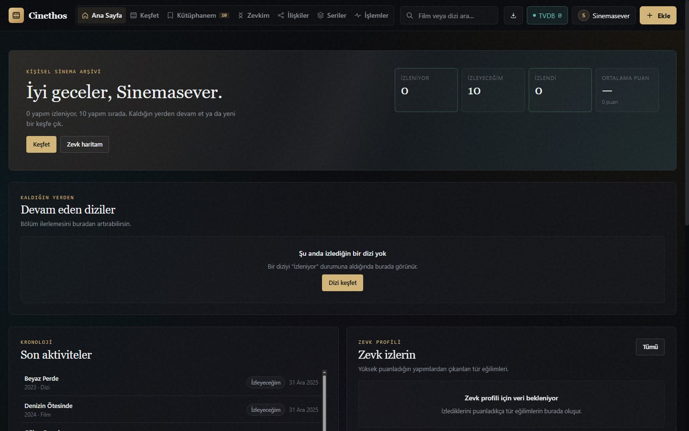
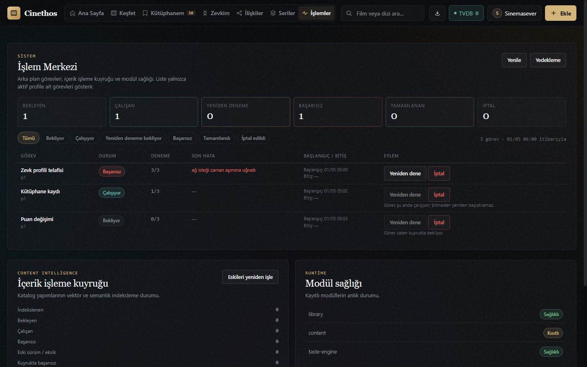
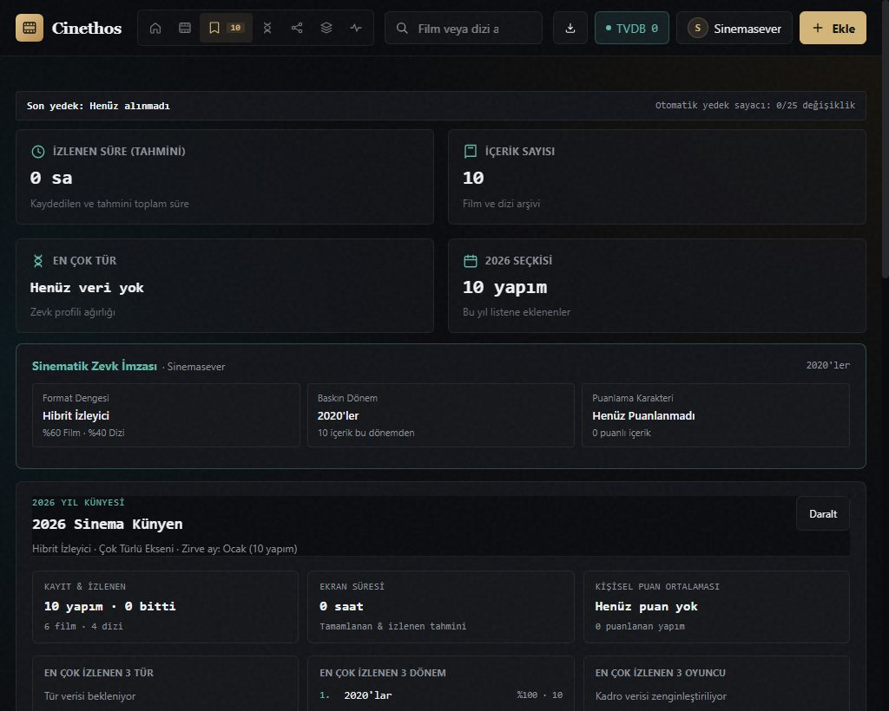
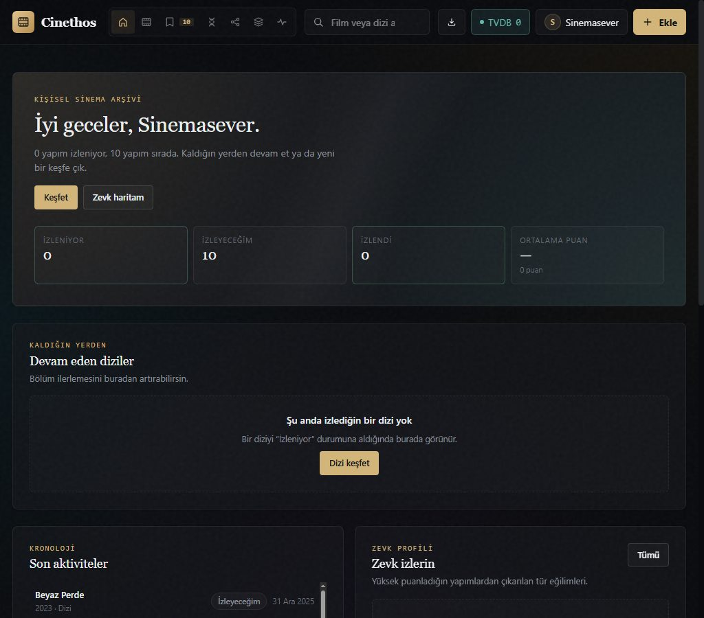
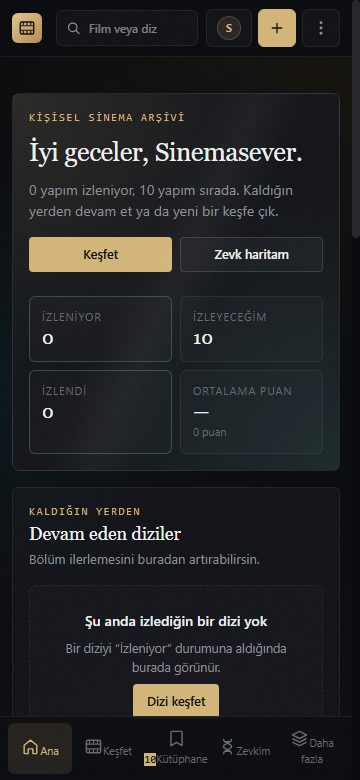
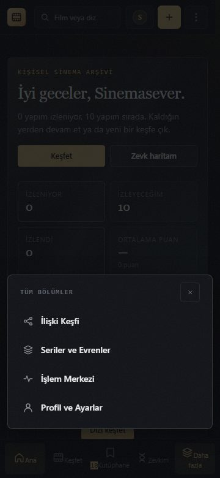

# Aşama 4 — Kapsamlı UI/UX yeniden tasarımı ve erişilebilirlik

**Kapsam:** B-24, B-25, B-26, B-27, B-28, B-29
**Branch:** `remediation/full-project-remediation` · **PR:** #65
**Başlangıç HEAD:** `977b701` · **Bitiş HEAD:** bu dokümanın commit'i (rapor sonunda)

Bu aşamada uygulamanın **görsel dili, bilgi hiyerarşisi, gezinme modeli, responsive
davranışı ve etkileşim katmanı** yeniden değerlendirildi. Buna karşılık iş mantığı,
veri akışları, API sözleşmeleri ve `data/` içeriği değiştirilmedi: tüm değişiklikler
sunum katmanı (CSS değişkenleri, kabuk bileşenleri, dialog/kısayol altyapısı, İşlem
Merkezi eylem politikası) ile sınırlı tutuldu.

---

## 1. Başlangıç durumu ve incelenen mimari

### 1.1 Ekran ve modül envanteri

| Modül | Rota | Ana amaç | En önemli bilgi | En sık eylem |
|---|---|---|---|---|
| Ana Sayfa | `#/home` | Kaldığı yerden devam etmek | Devam eden diziler, kütüphane özeti | "Keşfet", "Dizi keşfet" |
| Keşfet | `#/discover` | Yeni içerik bulmak | Öneri kartları + gerekçe | Kaydet, detay aç |
| Kütüphanem | `#/list` | Arşivi yönetmek | Kayıt sayısı, durum dağılımı | Durum/puan güncelle |
| Zevk Haritası | `#/taste-map` | Zevk profilini anlamak | Baskın tür/dönem | Sekme değiştir |
| İlişkiler | `#/relationships` | Oyuncu/yönetmen keşfi | İlişki grafiği | Düğüm seç |
| Seriler | `#/universes` | Evren/koleksiyon takibi | İlerleme | Detay aç |
| İşlemler | `#/operations` | Kuyruk ve modül sağlığı | Görev durumu, hata | Yeniden dene, iptal et |
| Profil | modal | Profil/ayar yönetimi | Aktif profil | Profil değiştir |

**Ortak bileşenler:** `Header`, `MobileLayout` (dock + sheet), `MediaCard`/poster,
`DetailModal`, `ProfileModal`, `CommandPalette`, `QuickSaveModal`, `AddCustomModal`,
`PersonDrawer`, `ImportChoiceModal`, `PaginatedMediaModal`, filtre çubuğu, boş/hata/
yükleniyor durumları, `Footer`.

**Overlay envanteri:** 8 modal + kişi drawer'ı + komut paleti + mobil taşma sheet'i.
Hepsi tek `useDialogAccessibility` sözleşmesine bağlandı.

### 1.2 Başlangıçtaki ölçümler

- Header masaüstünde **~88 px** yüksekliğindeydi (iki satır: kabuk + gezinme şeridi).
- 7 modül sekmesi 1024–1440 px aralığında **kesiliyordu** (`scrollWidth > clientWidth`).
- Mobilde üst alan **iki ayrı bileşenle** (`MobileTopBar` + `MobileDock`) çiziliyordu;
  dock'ta 4 öğe vardı, kalan 3 modül yalnızca "daha fazla" listesinden erişilebiliyordu.
- İki kopya dialog hook'u vardı: `src/hooks/useDialogAccessibility.ts` ve
  `src/utils/useDialogAccessibility.ts` (8 bileşen ikincisini kullanıyordu).
- `useKeyboardShortcuts` her render'da yeniden bağlanıyordu; modal açıkken arka plan
  kısayolları ve metin alanlarında tek harfli kısayollar tetiklenebiliyordu.
- İşlem Merkezi tüm eylem düğmelerini koşulsuz açıyordu.

### 1.3 Korunan sözleşmeler

`schemaVersion`, `data/` dosya biçimi, `/api/*` yanıtları, kuyruk/kilit davranışı,
öneri motoru ve cache geçerliliği **değişmedi**. Aşama 1–3 testleri aynen koştu.

---

## 2. Eski tasarımın tespit edilen sorunları

| # | Sorun | Etki |
|---|---|---|
| 1 | 1024–1440 px'te sekme kesilmesi | Son modüller (Seriler, İşlemler) erişilemez |
| 2 | Çift satırlı header | İçerik alanı ~88 px kaybediyordu |
| 3 | Mobilde 4 öğeli dock + ayrı top bar | Kritik modüller gizli, dokunma hedefi küçük |
| 4 | İki kopya dialog hook'u | Odak tuzağı bazı modallarda çalışmıyor, scroll lock yok |
| 5 | Arka plan `inert` değil | Ekran okuyucu modal arkasındaki içeriği okuyabiliyordu |
| 6 | Global kısayol guard'ı yok | Form yazarken `/`, `k`, `1–7` tetikleniyordu |
| 7 | İşlem Merkezi'nde koşulsuz eylemler | 409/403 sonrası tekrar deneme anlamsız istek üretiyordu |
| 8 | Kontrast: `footer-kbd`, `card-genres` | WCAG AA altı metin |
| 9 | `ws-hero-stats` içinde `role="list"` + yabancı çocuklar | `aria-required-children` ihlali |
| 10 | Sekme/TVDB/profil düğmelerinde sayaç metni | `label-content-name-mismatch` (ekran okuyucu adı görünen metinle uyuşmuyor) |
| 11 | Posterlerde sabit yükseklik, rozet üstte | Uzun başlıkta taşma, rozet/poster çakışması |
| 12 | Filtre çubuğu taşması | Dar ekranda filtreler kesiliyordu |

---

## 3. Yeni tasarım kararları ve gerekçeleri

### 3.1 Kabuk (B-24, B-25)

- **Tek satır masaüstü header, 64 px** (`--header-h`): solda marka (buton), ortada
  7 modül sekmesi, sağda arama + ikincil eylemler + profil + "Ekle".
- **Sekme etiketleri 1440 px altında görsel olarak gizlenir**, yerine ikon + `aria-label`
  + `title` kalır. Böylece 1024/1280'de hiçbir sekme kesilmez, erişilebilir ad korunur.
- **Aktif sekme** altın renk + 2 px alt çizgi + `aria-current="page"` ile üç kanaldan
  duyurulur (renk tek başına anlam taşımaz).
- **Mobil header 56 px** (`--header-h-mobile`): marka ikonu, arama, profil çipi, "Ekle",
  "Diğer" (`details.header-more`).
- **Mobil alt gezinme 5 öğe**: Ana, Keşfet, Kütüphanem, Zevkim, Daha fazla. Her hedef
  `--touch-target` (44 px) üstünde (ölçülen: 64×51 px). "Daha fazla" bir `details`
  sheet'i açar; Escape, odak dönüşü ve scroll lock paylaşılan hook'tan gelir.
- **`--safe-area-inset-*`** ile çentikli ekranlarda header/dock iç boşluğu korunur.
- **İkincil eylemler:** katalog kaynağı etiketi masaüstünde alt bilgiye ve "Diğer"
  menüsüne taşındı; PWA düğmesi 769 px üstünde ikon moduna geçer (işlev korunur,
  arama alanına ~115 px kalır).

### 3.2 Görsel dil (B-27, tasarım sistemi)

- Renk, tipografi, boşluk, radius, gölge ve odak halkası `src/styles/tokens.css`
  içinde tek kaynak. Yeni token'lar: `--header-h`, `--header-h-mobile`, `--control-h`,
  `--touch-target`, `--text-*` ölçeği, `--space-7/8`, `--radius-xl`, `--focus-ring`.
- Kabuk ve kart/filtre kuralları `style.css` sonunda iki blokta toplandı; `components.css`
  ve `workspace.css` içindeki yinelenen header/mobile-tab kuralları silindi.
- Ölü kod kaldırıldı: `MobileDock.tsx`, `MobileTopBar.tsx`, `design-system.css`.
- Posterler `aspect-ratio: 2/3`, rozetler posterin dışında başlık hizasında, grid
  `repeat(auto-fill, minmax(...))` ile viewport'a uyumlu; son kart kırpılmıyor.
- Filtre çubuğu yatay kaydırılabilir + kenar fade'i; `min-height` ile CLS engellendi.

### 3.3 Etkileşim ve erişilebilirlik (B-26, B-28, B-29)

- **Tek dialog hook'u** (`src/hooks/useDialogAccessibility.ts`): odak tuzağı, Escape,
  odak dönüşü, scroll lock, kabuk bölgelerine `inert`, en üst dialog yığını, `onClose`
  için ref (odak çalınması hatası giderildi). `src/utils/useDialogAccessibility.ts`
  silindi, 8 bileşen importu güncellendi.
- **Tek klavye dinleyicisi**: `useKeyboardShortcuts` ref'li handler'larla bir kez bağlanır;
  `src/utils/overlay-guard.ts` (`isOverlayOpen`, `isTypingTarget`,
  `shouldHandleGlobalShortcut`) overlay ve metin girişinde global kısayolları kapatır.
  Header'ın `/` ve `k` dinleyicisi de aynı guard'ı kullanır.
- **Atlama bağlantısı** ve `main#main-content` (`tabIndex={-1}`); modül değişiminde
  `role="status"` canlı bölge duyurusu.
- **B-26 politikası** `src/modules/operations/task-actions.ts` içinde tek kaynak:
  - `retry` yalnız `failed | cancelled | retry_wait | completed`
  - `cancel` yalnız `pending | processing | retry_wait | failed`
  - 409/403/404 kalıcı hata → düğme kapalı + gerekçe metni
  - hata teknik detayı `
` içinde, kullanıcıya sade özet.
- İşlem Merkezi uçları `Promise.allSettled` ile bağımsız yüklenir; bir uç düşse diğerleri
  görünür kalır ve hata satırı gösterilir.

---

## 4. Bulgu bazlı kök neden, değişiklik ve test kanıtı

### B-24 — Navigasyon ve sekme erişilebilirliği

- **Kök neden:** Sekmeler etiketli ve sabit genişlikliydi; 1024 px'te toplam genişlik
  kabuğu aşıyor, `overflow` kesiyordu.
- **Değişiklik:** `Header.tsx` yeniden yazıldı — 7 sekme, `aria-current`, ikon + etiket,
  <1440 px'te etiket gizleme (erişilebilir ad korunur), marka `button`, mobil
  `details.header-more`, `navigation.ts` içine `iconRef`.
- **Kanıt:** 1024/1280/1440/1920 px'te `nav.scrollWidth - nav.clientWidth = 0`
  (tarayıcı ölçümü); 13 yeni unit test (`tests/phase4-shell-contracts.test.mjs` 5 test),
  `e2e/phase4-shell.spec.ts` B-24 senaryoları (1024/1280/1440 taşma, `aria-current`,
  mobil dock dokunma hedefi + sheet).

### B-25 — Header ve responsive yerleşim

- **Kök neden:** Kabuk iki satıra bölünmüş, mobilde ikinci bir top bar vardı.
- **Değişiklik:** Tek satır 64 px (mobil 56 px); arama `flex:1`, ikincil eylemler
  kompaktlaştırıldı; safe-area; sticky yükseklik `--header-h` ile içerik padding'ine
  bağlandı (içerik sticky alanın altına girmiyor).
- **Kanıt:** Ölçülen header yüksekliği 65 px (masaüstü) / 57 px (mobil); 360–1920 px
  aralığında `document.scrollWidth - innerWidth = -8` (yalnızca dikey kaydırma çubuğu);
  arama genişliği 142 / 182 / 205 / 249 px (360 / 1024 / 1440 / 1920) — hiçbir genişlikte
  kullanılamaz duruma düşmüyor. `e2e/phase4-shell.spec.ts` atlama bağlantısı testi.

### B-26 — İşlem Merkezi ve işlem durumları

- **Kök neden:** Düğmeler görev durumundan bağımsız çiziliyor, hata türü ayrıştırılmıyordu.
- **Değişiklik:** `task-actions.ts` tek politika kaynağı; `OperationsSection.tsx`
  politika tabanlı düğmeler, gerekçe metni, `TASK_STATUS_HUMAN`, `allSettled` yükleme,
  kalıcı hata sonrası düğme devre dışı; `.ws-btn:disabled` görsel ayrımı.
- **Kanıt:** `tests/phase4-task-actions.test.mjs` 8 test (retry/cancel matrisi, 409/403/404,
  bilinmeyen durum, eşzamanlı eylem engeli). Tarayıcıda `failed` → "Yeniden dene" açık,
  `pending` → kapalı + "Görev zaten kuyrukta bekliyor.", 409 yanıtı sonrası düğme kapalı
  ve mesaj görünür; modül sağlığı ve kuyruk derinliği ayrı kartlarda.
  Görsel: `phase4/desktop-1440-operations.jpg`.

### B-27 — Kart, poster, filtre ve içerik düzeni

- **Kök neden:** Sabit poster yüksekliği + absolute rozetler; filtre çubuğu `nowrap`
  olmadan taşıyordu.
- **Değişiklik:** `aspect-ratio` poster, rozetler başlık hizasında, `auto-fill` grid,
  uzun başlıkta 2 satır clamp, filtre çubuğunda yatay kaydırma + fade, görsel için
  `min-height` (CLS yok), boş/yükleniyor/hata/sonuç durumları aynı yüzey dilinde.
- **Kanıt:** 10 kartlık gerçekçi veriyle (uzun başlık, eksik poster, çoklu rozet) 1024 ve
  360 px görselleri: `phase4/desktop-1024-library.jpg`, `phase4/mobile-360-home.jpg`;
  yatay taşma yok, son kart kırpılmıyor.

### B-28 — Modal ve overlay erişilebilirliği

- **Kök neden:** İki kopya hook, `inert` yok, scroll lock yok, bazı modallarda odak
  dönüşü çalışmıyordu.
- **Değişiklik:** Tek kanonik hook (overload: `options` ve `(open, onClose) → ref`),
  `inert` kabuk bölgeleri, dialog yığını, `aria-labelledby`/`aria-describedby`,
  `onClose` ref'i, scroll lock.
- **Kanıt:** Tarayıcıda `DetailModal` açıkken Tab döngüsü: 0 odak kaçışı, `inert` aktif,
  Escape sonrası odak açan düğmeye dönüş; mobil sheet aynı davranışı gösteriyor
  (`phase4/mobile-360-more-sheet.jpg`). `e2e/phase4-shell.spec.ts` odak tuzağı testi.

### B-29 — Klavye handler ve kısayollar

- **Kök neden:** Handler'lar her render'da yeniden bağlanıyor, guard yoktu.
- **Değişiklik:** Ref'li tek dinleyici, `overlay-guard.ts`, `search-input` sınıfı
  (App'in `/` kısayolu artık arama alanına odaklanıyor), modal açıkken global kısayol yok,
  `input/textarea/select/contenteditable` korunuyor, ipuçları yalnızca ince işaretçide.
- **Kanıt:** `e2e/phase4-shell.spec.ts` "kısayollar metin girişinde ve modal açıkken
  çalışmaz"; tarayıcıda `/` → arama odak, `k` metin alanında yazı olarak giriyor.

---

## 5. Ekran görüntüleri

Masaüstü (1440 px, gerçekçi katalog verisi):

Küçük masaüstü (1024 px) — etiketler ikona çekilmiş, tüm sekmeler erişilebilir:

Mobil (360 px) — tek satır header, 5 öğeli dock ve "Daha fazla" sheet'i:

---

## 6. Responsive test matrisi

Ölçüm: Chromium (bulut tarayıcı), üretim derlemesi, `?v=` cache-bust, gerçekçi katalog
verisi (10 kayıt, uzun başlık, eksik poster).

| Viewport | Yatay taşma | Nav kesilmesi | Header | Arama | Dock / sheet | Sonuç |
|---|---|---|---|---|---|---|
| 360 px | yok (-8) | 0 | 57 px | 142 px | 5 öğe, sheet ✅ | ✅ |
| 390 px | yok (-8) | 0 | 57 px | 172 px | 5 öğe | ✅ |
| 768 px | yok (-8) | 0 | 57 px | 538 px | dock | ✅ |
| 1024 px | yok (-8) | 0 | 65 px | 182 px | — | ✅ |
| 1280 px | yok (-8) | 0 | 65 px | 380 px | — | ✅ |
| 1440 px | yok (-8) | 0 | 65 px | 205 px | — | ✅ |
| 1920 px | yok (-8) | 0 | 65 px | 249 px | — | ✅ |

`-8` değeri dikey kaydırma çubuğu genişliğidir (içerik taşması değil).

Ekran bazlı kontroller (her viewport): ana ekran, gezinme, kartlar, filtreler,
modal/overlay, İşlem Merkezi, profil modalı, yatay taşma.

---

## 7. Erişilebilirlik taraması

**Araç:** axe-core (WCAG 2.0/2.1 A + AA etiketleri), üretim derlemesi üzerinde.
**Kapsam:** 5 ekran (ana sayfa, kütüphane, keşfet, işlem merkezi, zevk haritası) ×
1440 / 768 / 360 px.

### 7.1 Bulunan ve düzeltilen ihlaller

| Kural | Etki | Düğüm | Düzeltme |
|---|---|---|---|
| `aria-required-children` | critical | `.ws-hero-stats` (`role="list"`) | `role="group"` + `aria-label` |
| `color-contrast` | serious | `.footer-kbd` | `--text-1` + yüzey token'ı |
| `color-contrast` | serious | `.card-genres` (48 düğüm) | kontrast oranı AA üstüne çıkarıldı |
| `label-content-name-mismatch` | serious | Kütüphanem sekmesi sayacı | sayaç CSS `content: attr(data-count)` ile çizilir, ad = etiket, ad `aria-description`'da |
| `label-content-name-mismatch` | serious | `.tvdb-stock-btn` | `aria-label` görünen "TVDB" metnini içerir, sayı CSS ile |
| `label-content-name-mismatch` | serious | `#profileButton` | avatar baş harfi CSS ile, ad görünen profil adını içerir |
| `label-content-name-mismatch` | serious | mobil dock "Kütüphane" | aynı sayaç tekniği |

### 7.2 Son tarama

| Viewport | Ekran sayısı | Kritik | Ciddi | Sonuç |
|---|---|---|---|---|
| 1440 px | 5 | 0 | 0 | ✅ |
| 768 px | 4 | 0 | 0 | ✅ |
| 360 px | 5 | 0 | 0 | ✅ |

**İstisna:** yok. Kalan ihlal bildirilmedi.

### 7.3 Elle doğrulanan maddeler

Görünür odak halkası (altın, `--focus-ring`), klavye ile tam gezinme, başlık hiyerarşisi,
düğme/link adları, form label ilişkileri (`aria-labelledby`), poster `alt` metinleri,
`prefers-reduced-motion` desteği, 44 px dokunma hedefleri.

---

## 8. Eklenen ve değiştirilen testler

### 8.1 Birim/regresyon testleri (yeni, 13)

| Dosya | Test | Kapsam |
|---|---|---|
| `tests/phase4-task-actions.test.mjs` | 8 | B-26 politika matrisi, 409/403/404, bilinmeyen durum |
| `tests/phase4-shell-contracts.test.mjs` | 5 | B-24/B-25 kabuk sözleşmeleri (modül listesi, token varlığı, overlay guard) |

### 8.2 Playwright E2E (yeni, 11)

| Dosya | Test | Kapsam |
|---|---|---|
| `e2e/phase4-shell.spec.ts` | 6 | 1024/1280/1440 taşma, `aria-current`, mobil dock + sheet, atlama bağlantısı, kısayol guard'ı, modal odak tuzağı |
| `e2e/phase4-a11y.spec.ts` | 5 | axe taraması (4 ekran) + mobil dock erişilebilirliği |

`e2e/fixtures.ts` içine `taskActionResponder` eklendi (görev eylemi yanıtları).

### 8.3 Değiştirilen mevcut testler

Yok. Hiçbir test silinmedi, atlanmadı veya beklentisi düşürülmedi.

---

## 9. Çalıştırılan kalite kapıları

| Kapı | Komut | Sonuç |
|---|---|---|
| Lint + tip kontrolü | `npm run lint` (eslint + `tsc --noEmit` ×2) | **0 hata, 0 uyarı** |
| Döngüsel bağımlılık | `npm run cycles` | **0** |
| Birim testleri | `npm test` | **816/816** (803 → +13) |
| Öneri motoru testleri | `npm run test:taste` | **440/440** |
| Üretim derlemesi | `npm run build` | **başarılı** |
| Veri bütünlüğü | `node scripts/check-data-integrity.mjs verify .audit/data-before-phase4.json` | **OK — 15 dosya değişmedi** |
| Responsive matris | Chromium (bulut tarayıcı) ölçümleri | **7/7 viewport temiz** |
| axe taraması | axe-core WCAG 2.1 AA | **0 kritik / 0 ciddi** |
| Modal + klavye testleri | tarayıcı + E2E spec | odak tuzağı 0 kaçış, Escape, odak dönüşü ✅ |
| Playwright E2E (yerel) | `npx playwright test` | **çalıştırılamadı** (aşağıda) |

---

## 10. Yerel ve CI sonuçlarının ayrı dökümü

### 10.1 Yerel (bu çalışma ortamı)

- `npm run lint` ✅ · `npm run cycles` ✅ · `npm test` 816/816 ✅ ·
  `npm run test:taste` 440/440 ✅ · `npm run build` ✅
- Tarayıcı doğrulaması: gerçek Chromium (bulut tarayıcı) üzerinde responsive matris,
  axe taraması, modal/odak/kısayol senaryoları ve ekran görüntüleri ✅
- **Playwright CLI (yerel):** tarayıcı ikilisi sistem kütüphaneleri olmadan başlatılamıyor:
  `chrome-headless-shell: error while loading shared libraries: libnspr4.so`
  (ayrıca `libnss3`, `libatk*`, `libX*` yok). `playwright install-deps` ve `sudo`
  bu ortamda kapalı ("no new privileges"); paket listeleri bulunmadığı için
  `apt-get download` da başarısız. **Bu nedenle yerel E2E sonucu "geçti" sayılmadı.**

### 10.2 CI (GitHub Actions)

CI sonucu bu dokümanın commit'i push edildikten sonra PR #65 kontrollerinden okunur;
sonuç raporun sonundaki tabloya işlenir. Yerel E2E engeli CI'da geçerli değildir:
workflow imajında Playwright bağımlılıkları kurulur.

---

## 11. Veri bütünlüğü ve hash sonucu

- Aşama başında `data/` dizininin sha256 manifesti alındı (15 dosya).
- Aşama sonunda karşılaştırma: **değişmedi**.
- Geliştirme sırasında üretim modunda çalıştırılan sunucunun oluşturduğu geçici
  `data/cinetrack.db*` dosyaları silindi; karşılaştırma sonrası tekrar **OK**.
- `schemaVersion`, `data/cinetrack-data.json` biçimi ve migration mekanizması
  değiştirilmedi. Yeni UI yerel modda (API olmadan) tam çalışır.

---

## 12. Önceki aşamalarla uyumluluk

| Aşama | Korunan davranış | Doğrulama |
|---|---|---|
| 1 — Veri güvenliği | Kayıpsız birleştirme, yedek/restore, eşikler | `npm test` 816/816, `data/` hash |
| 2 — Senkronizasyon | FIFO kuyruk, dosya kilidi, 409, fail-closed | `npm test`, `npm run cycles` |
| 3 — Öneri motoru | Tek hat, film/dizi kapsamı, top-up filtreleri, cache | `npm run test:taste` 440/440 |
| Production local-only | API yokken UI tam çalışır | Tarayıcıda yerel mod doğrulandı |

Sunum katmanı dışında iş mantığı dosyası değişmedi; `OperationsSection` yalnızca
*eylem etkinliği* kararını merkezi politikaya devretti (davranış aynı kaldı).

---

## 13. Ertelenen işler ve kalan riskler

1. **Yerel E2E çalıştırılamıyor** (sistem kütüphaneleri). Yeni 11 E2E testi CI'da
   ilk kez koşacak; ilk koşuda kırılgan seçici çıkarsa düzeltme Aşama 4 kapsamında kalır.
2. **1440 px altında ikon-only sekmeler**: etiketler gizli, ad `aria-label` + `title` ile
   veriliyor. Kullanıcı testinde ikon tanınırlığı ölçülmedi (kapsam dışı: ürün araştırması).
3. **Katalog kaynağı etiketi masaüstünde** alt bilgiye taşındı; üst çubukta yalnızca
   mobilde görünüyor. Bilgi kaybı yok, konum değişikliği bilinçli.
4. **Renk paleti** mevcut altın/koyu kimliği korunarak rafine edildi; tam marka yenilemesi
   yapılmadı (kapsam: Aşama 4 UI, marka çalışması değil).
5. **`docs/ROADMAP.md` bu depoda mevcut değil**; yol haritası işlevini
   `docs/DEVELOPMENT_REMEDIATION_PLAN.md` yürütüyor ve bu doküman orada §17.7 ile
   güncellendi. İkinci bir yol haritası dosyası oluşturulmadı.
6. **Aşama 5 konuları** (büyük dosya ayrıştırma, `App.tsx` bölünmesi, test kalitesi)
   bu aşamaya taşınmadı.

---

## 14. Commit SHA ve PR/CI durumu

| Öğe | Değer |
|---|---|
| Branch | `remediation/full-project-remediation` |
| PR | #65 (açık, merge edilmedi) |
| Başlangıç HEAD | `977b701` |
| Commit'ler | aşağıdaki tablo (push sonrası PR head SHA'sı doğrulanır) |

Commit grupları:

1. `design tokens + kabuk + kart/filtre` — `tokens.css`, `style.css`, `components.css`,
   `workspace.css`, `features.css`, `Header.tsx`, `navigation.ts`, `MobileLayout.tsx`,
   `App.tsx`, ölü kod silme.
2. `B-26 işlem politikası` — `task-actions.ts`, `OperationsSection.tsx`.
3. `dialog + klavye erişilebilirliği` — `useDialogAccessibility.ts`, `overlay-guard.ts`,
   `useKeyboardShortcuts.ts`, 8 modal bileşeni.
4. `testler` — `tests/phase4-*.test.mjs`, `e2e/phase4-*.spec.ts`, `fixtures.ts`,
   `@axe-core/playwright` bağımlılığı.
5. `denetim dokümanı` — bu dosya, `DEVELOPMENT_REMEDIATION_PLAN.md`, ekran görüntüleri.

> CI durumu ve nihai SHA, push sonrası PR #65 üzerinden doğrulanır; bu tablo
> doğrulama sonucuyla güncellenir.
