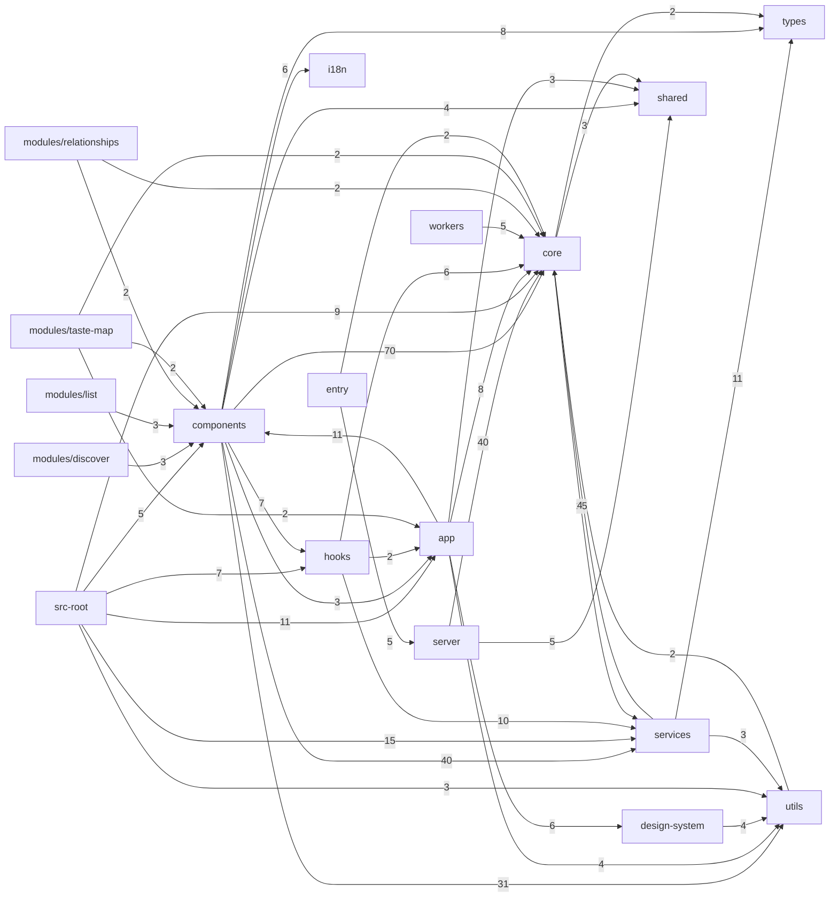

# MIA Faz 0 — Gerçek Import Grafiği ve Bağımlılık Haritası

> **Üretim:** `npm run inventory:arch` (`scripts/arch-inventory.mjs`) · kaynak: `src/` + `server.ts`
> **Ham veri:** [`faz0-envanter-veri.md`](./faz0-envanter-veri.md) — modül matrisi §10, dosya düzeyinde **tüm** import kenarları §13, fan-in tabloları §4.
> **Sayılar:** 202 kaynak dosya · 640 dosya-arası import kenarı (130'u `import type`) · 407 modül-arası kenar · 53 yönlü modül çifti · 3 döngüsel bileşen (1 gerçek değer döngüsü) · 4 katman ihlali.

## 1. Modül bağımlılık matrisi ve dosya örnekleri

Modüller arası 407 import kenarı, 53 yönlü modül çifti (modül içi kenarlar hariç). Mermaid grafiği yalnızca ≥2 kenarlı bağımlılıkları gösterir.



| Kaynak \ Hedef | app | components | core | design-system | entry | hooks | i18n | modules/discover | modules/list | modules/relationships | modules/taste-map | server | services | shared | src-root | types | utils | workers |
| --- | --- | --- | --- | --- | --- | --- | --- | --- | --- | --- | --- | --- | --- | --- | --- | --- | --- | --- |
| app | · | 11 | 8 | 6 | · | 1 | · | 1 | 1 | · | · | · | 1 | 3 | · | 1 | 4 | · |
| components | 3 | · | 70 | · | · | 7 | 6 | · | · | · | · | · | 40 | 4 | · | 8 | 31 | · |
| core | · | · | · | · | · | · | · | · | · | · | · | · | 4 | 3 | · | 2 | 1 | · |
| design-system | · | · | · | · | · | · | · | · | · | · | · | · | · | · | · | · | 4 | · |
| entry | · | · | 2 | · | · | · | · | · | · | · | · | 5 | · | · | · | · | · | · |
| hooks | 2 | · | 6 | · | · | · | · | · | · | · | · | · | 10 | · | · | · | 1 | · |
| i18n | · | · | · | · | · | · | · | · | · | · | · | · | · | 1 | · | · | · | · |
| modules/discover | · | 3 | · | · | · | · | · | · | · | · | · | · | · | · | · | · | · | · |
| modules/list | · | 3 | · | · | · | · | · | · | · | · | · | · | · | · | · | · | · | · |
| modules/relationships | 1 | 2 | 2 | · | · | · | · | · | · | · | · | · | · | · | · | · | · | · |
| modules/taste-map | 2 | 2 | 2 | · | · | · | · | · | · | · | · | · | · | · | · | · | · | · |
| server | · | · | 40 | · | · | · | · | · | · | · | · | · | · | 5 | · | · | · | · |
| services | · | · | 25 | · | · | · | · | · | · | · | · | · | · | · | · | 11 | 3 | · |
| shared | · | · | · | · | · | · | · | · | · | · | · | · | · | · | · | · | · | · |
| src-root | 11 | 5 | 9 | · | · | 7 | · | · | · | · | · | · | 15 | 1 | · | · | 3 | · |
| types | · | · | · | · | · | · | · | · | · | · | · | · | · | · | · | · | · | · |
| utils | · | · | 2 | · | · | · | · | · | · | · | · | · | · | · | · | 1 | · | · |
| workers | · | · | 5 | · | · | · | · | · | · | · | · | · | · | · | · | · | · | · |

### Modül → bağımlı olduğu modüller

| Modül | Hedef modüller (kenar sayısı) | Örnek dosya kenarları |
| --- | --- | --- |
| `app` | components (11)<br>core (8)<br>design-system (6)<br>utils (4)<br>shared (3)<br>services (1)<br>hooks (1)<br>modules/discover (1)<br>modules/list (1)<br>types (1) | `src/app/AppModals.tsx → src/components/DetailModal.tsx`<br>`src/app/AppModals.tsx → src/components/QuickSaveModal.tsx`<br>`src/app/AppModals.tsx → src/components/PersonDrawer.tsx`<br>`src/app/AppModals.tsx → src/core/cinethos-core.ts` |
| `components` | core (70)<br>services (40)<br>utils (31)<br>types (8)<br>hooks (7)<br>i18n (6)<br>shared (4)<br>app (3) | `src/components/ActorRecommendationsSection.tsx → src/core/cinethos-core.ts`<br>`src/components/CommandPalette.tsx → src/core/cinethos-core.ts`<br>`src/components/DetailModal.tsx → src/core/cinethos-core.ts`<br>`src/components/ActorRecommendationsSection.tsx → src/services/actor-recommendations-engine.ts` |
| `core` | services (4)<br>shared (3)<br>types (2)<br>utils (1) | `src/core/actor-recommendations.ts → src/services/api-client.ts`<br>`src/core/relationship-explorer.ts → src/services/encoding-service.ts`<br>`src/core/relationship-explorer.ts → src/services/storage-idb.ts`<br>`src/core/cinethos-core.ts → src/shared/brand.ts` |
| `design-system` | utils (4) | `src/design-system/cards/DiscoveryCard.tsx → src/utils/helpers.ts`<br>`src/design-system/cards/HeroCard.tsx → src/utils/helpers.ts`<br>`src/design-system/cards/ProgressCard.tsx → src/utils/helpers.ts` |
| `entry` | server (5)<br>core (2) | `server.ts → src/server/app.ts`<br>`server.ts → src/server/config.ts`<br>`server.ts → src/server/github-token-refresh.ts`<br>`server.ts → src/core/limits.ts` |
| `hooks` | services (10)<br>core (6)<br>app (2)<br>utils (1) | `src/hooks/useCinemaKunye.ts → src/services/api.ts`<br>`src/hooks/useItemActions.ts → src/services/taste-api.ts`<br>`src/hooks/useOfflineSync.ts → src/services/api.ts`<br>`src/hooks/useCinemaKunye.ts → src/core/cinethos-core.ts` |
| `i18n` | shared (1) | `src/i18n/index.ts → src/shared/brand.ts` |
| `modules/discover` | components (3) | `src/modules/discover/DiscoverSection.tsx → src/components/Hero.tsx`<br>`src/modules/discover/DiscoverSection.tsx → src/components/MediaGrid.tsx`<br>`src/modules/discover/DiscoverSection.tsx → src/components/ErrorBoundary.tsx` |
| `modules/list` | components (3) | `src/modules/list/ListSection.tsx → src/components/Stats.tsx`<br>`src/modules/list/ListSection.tsx → src/components/MediaGrid.tsx`<br>`src/modules/list/ListSection.tsx → src/components/ErrorBoundary.tsx` |
| `modules/relationships` | components (2)<br>core (2)<br>app (1) | `src/modules/relationships/RelationshipsSection.tsx → src/components/ErrorBoundary.tsx`<br>`src/modules/relationships/RelationshipsSection.tsx → src/components/RelationshipExplorer.tsx`<br>`src/modules/relationships/RelationshipsSection.tsx → src/core/cinethos-core.ts`<br>`src/modules/relationships/RelationshipsSection.tsx → src/core/relationship-semantics.ts` |
| `modules/taste-map` | components (2)<br>app (2)<br>core (2) | `src/modules/taste-map/TasteMapSection.tsx → src/components/ErrorBoundary.tsx`<br>`src/modules/taste-map/TasteMapSection.tsx → src/components/TasteMapView.tsx`<br>`src/modules/taste-map/TasteMapSection.tsx → src/app/lazy-with-retry.ts`<br>`src/modules/taste-map/TasteMapSection.tsx → src/app/shell-context.tsx` |
| `server` | core (40)<br>shared (5) | `src/server/app.ts → src/core/cinethos-core.ts`<br>`src/server/app.ts → src/core/limits.ts`<br>`src/server/archive-integrity.ts → src/core/cinethos-core.ts`<br>`src/server/app.ts → src/shared/brand.ts` |
| `services` | core (25)<br>types (11)<br>utils (3) | `src/services/actor-recommendations-engine.ts → src/core/cinethos-core.ts`<br>`src/services/api.ts → src/core/cinethos-core.ts`<br>`src/services/api.ts → src/core/cinema-kunye.ts`<br>`src/services/actor-recommendations-engine.ts → src/types/tmdb.ts` |
| `src-root` | services (15)<br>app (11)<br>core (9)<br>hooks (7)<br>components (5)<br>utils (3)<br>shared (1) | `src/App.tsx → src/services/discovery-storage.ts`<br>`src/App.tsx → src/services/api.ts`<br>`src/App.tsx → src/services/offline-queue.ts`<br>`src/App.tsx → src/app/AppFooter.tsx` |
| `utils` | core (2)<br>types (1) | `src/utils/helpers.ts → src/core/cinethos-core.ts`<br>`src/utils/helpers.ts → src/core/media/poster.ts`<br>`src/utils/helpers.ts → src/types/tmdb.ts` |
| `workers` | core (5) | `src/workers/encoding.worker.ts → src/core/encoding.ts`<br>`src/workers/taste-profile-worker.ts → src/core/taste/feature-extractor.ts`<br>`src/workers/taste-profile-worker.ts → src/core/taste/profile-aggregator.ts` |

## 2. Döngüsel bağımlılıklar

| # | Dosyalar | Kenar | type-only | Niteliği |
| --- | --- | --- | --- | --- |
| 1 | `src/core/actor-recommendations.ts`<br>`src/core/candidate-pool-store-port.ts`<br>`src/core/cinema-kunye.ts`<br>`src/core/cinethos-core.ts`<br>`src/core/ring-lifecycle.ts` | 8 | 4 | tip ile kırılıyor<br>- src/core/cinethos-core.ts → src/core/cinema-kunye.ts<br>- src/core/cinethos-core.ts → src/core/candidate-pool-store-port.ts<br>- src/core/cinethos-core.ts → src/core/ring-lifecycle.ts<br>- src/core/cinethos-core.ts → src/core/actor-recommendations.ts |
| 2 | `src/core/relationship-explorer.ts`<br>`src/core/relationship-semantics.ts`<br>`src/core/relationship-wordlists.ts` | 4 | 1 | tip ile kırılıyor<br>- src/core/relationship-explorer.ts → src/core/relationship-wordlists.ts<br>- src/core/relationship-explorer.ts → src/core/relationship-semantics.ts<br>- src/core/relationship-semantics.ts → src/core/relationship-wordlists.ts |
| 3 | `src/server/github-bidirectional-sync.ts`<br>`src/server/github-catalog-sync.ts`<br>`src/server/persistent-store.ts` | 4 | 0 | **değer döngüsü** |

**Yorum:** Yalnızca 3 numaralı bileşen gerçek değer döngüsüdür (`persistent-store` → `github-bidirectional-sync` → `github-catalog-sync` → `persistent-store`). Diğer ikisi `import type` kenarlarıyla kırılıyor; Faz 1'de `core/media/types.ts` çıkarıldığında tamamen kaybolurlar.

## 3. Katman ihlalleri

| Kural | Kaynak | Hedef | Tür |
| --- | --- | --- | --- |
| `core-services` | `src/core/actor-recommendations.ts` | `src/services/api-client.ts` | **değer** |
| `core-services` | `src/core/relationship-explorer.ts` | `src/services/encoding-service.ts` | **değer** |
| `core-services` | `src/core/relationship-explorer.ts` | `src/services/storage-idb.ts` | **değer** |
| `core-services` | `src/core/relationship-explorer.ts` | `src/services/series-tv-seeds.ts` | **değer** |

Hepsi `core/` içinden `services/`'e **değer** importudur. Faz 5'te port arayüzüne çevrilecek (plan §1 Yönetici 5).

## 4. Hedef mimaride izin verilen yönler

| Kaynak | Okuyabilir | Yazamaz / import edemez |
| --- | --- | --- |
| `presentation/` (Deneyim) | tüm yönetici `service.ts` sorguları | repository, adaptör, `server/` |
| `modules/library` | İçerik, Veri servisleri | Zevk hafızası |
| `modules/content` | TMDB, katalog, Veri | kullanıcı puanları |
| `modules/intelligence/taste` | Kütüphane olayları, içerik özellikleri | kütüphane kayıtları |
| `modules/intelligence/memory` | Zevk olayları, içerik özellikleri | kullanıcı listeleri |
| `modules/intelligence/relationships` | Hafıza, içerik özellikleri | profil kayıtları |
| `modules/recommendations` | Zevk profili, katalog, geri bildirim | hafıza kayıtları |
| `modules/data` | repository istekleri | iş mantığı kararları |
| `modules/background` | olaylar, zamanlanmış görevler | modüllerin özel verisi |
| `core/` (saf) | yalnız `core/` + `types/` | `services/`, `server/`, React |

Bu kurallar Faz 8'de `no-restricted-imports`/dependency-cruiser testine dönüşecek; bugünkü ihlal listesi yukarıdaki 4 kayıttır.

## 5. Tam kenar listesi nerede?

640 dosya-arası kenarın tamamı [`faz0-envanter-veri.md` §13](./faz0-envanter-veri.md#13-ek--dosya-düzeyinde-import-kenarları) altında, kaynak dosyaya göre gruplanmış olarak listelenir (`import type` kenarları *(tip)* işaretlidir). Yeniden üretmek için:

```bash
npm run inventory:arch            # markdown
npm run inventory:arch -- --json  # makine okunur
npm run inventory:arch -- --write # docs/mia/faz0-envanter-veri.md
```
