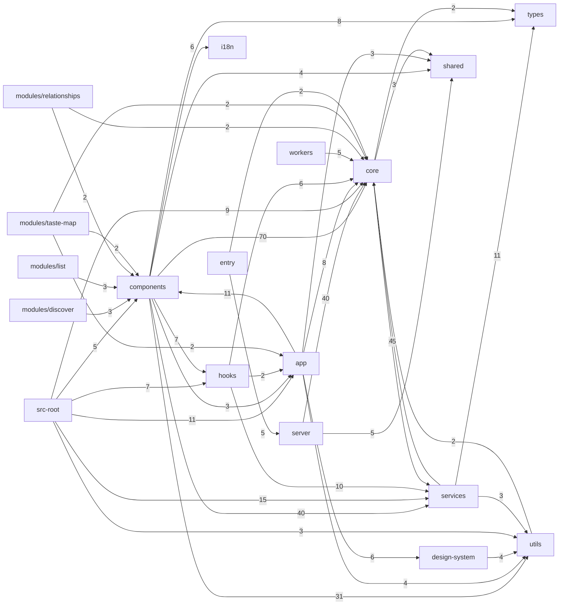

# MIA Faz 0 — Doğrulanmış Envanter Verisi

> **Üretim:** `node scripts/arch-inventory.mjs --write` · 2026-11-16T00:43:42.337Z
> **Kapsam:** `src/` + `server.ts` — 202 kaynak dosya, 25 test dosyası, 204 statik test bloğu (çalıştırıcı alt testlerle daha fazla vaka raporlar).

## 1. Özet

| Metrik | Değer |
| --- | --- |
| Kaynak dosya | 202 |
| Toplam satır | 82.134 |
| İç import kenarı | 640 |
| Bunlardan `import type` | 130 |
| Döngüsel bileşen (SCC) | 3 |
| Gerçek değer döngüsü (yalnız değer kenarları) | 1 |
| Katman ihlali | 4 |
| Dışa açılan sembol | 1414 |

## 2. Katman Dağılımı

| Katman | Dosya | Satır |
| --- | --- | --- |
| `server` | 22 | 22.224 |
| `core` | 52 | 20.390 |
| `components` | 54 | 17.854 |
| `services` | 25 | 11.162 |
| `src-root` | 3 | 4.693 |
| `app` | 13 | 1.824 |
| `hooks` | 11 | 1.672 |
| `utils` | 6 | 739 |
| `design-system` | 6 | 503 |
| `server-entry` | 1 | 328 |
| `modules` | 4 | 292 |
| `workers` | 2 | 196 |
| `types` | 1 | 179 |
| `i18n` | 1 | 62 |
| `shared` | 1 | 16 |

## 3. En Büyük 25 Dosya

| Dosya | Satır | fan-in | fan-out | export |
| --- | --- | --- | --- | --- |
| `src/server/github-bidirectional-sync.ts` | 4.754 | 1 | 12 | 7 |
| `src/core/cinetrack-core.ts` | 4.691 | 72 | 12 | 119 |
| `src/App.tsx` | 4.651 | 1 | 49 | 1 |
| `src/server/persistent-store.ts` | 4.230 | 6 | 7 | 23 |
| `src/server/excel-profile-backup.ts` | 3.447 | 1 | 6 | 61 |
| `src/server/app.ts` | 2.281 | 1 | 15 | 6 |
| `src/services/api.ts` | 1.788 | 21 | 4 | 74 |
| `src/core/exporters.ts` | 1.054 | 10 | 3 | 17 |
| `src/server/tmdb-proxy.ts` | 1.049 | 1 | 0 | 9 |
| `src/components/DetailModal.tsx` | 1.041 | 1 | 8 | 1 |
| `src/core/cinema-kunye.ts` | 1.030 | 17 | 1 | 29 |
| `src/services/stock-engine.ts` | 992 | 9 | 8 | 27 |
| `src/components/RelationshipExplorer.tsx` | 988 | 3 | 10 | 1 |
| `src/components/IdentityView.tsx` | 973 | 0 | 4 | 3 |
| `src/services/series-service.ts` | 947 | 7 | 7 | 19 |
| `src/components/MediaGrid.tsx` | 941 | 2 | 9 | 1 |
| `src/core/relationship-explorer.ts` | 926 | 7 | 9 | 6 |
| `src/components/ProfileGitHubSyncSection.tsx` | 857 | 2 | 5 | 2 |
| `src/core/relationship-semantics.ts` | 791 | 2 | 3 | 31 |
| `src/core/user-data-merge.ts` | 785 | 3 | 3 | 7 |
| `src/core/actor-recommendations.ts` | 781 | 1 | 6 | 15 |
| `src/server/storage.ts` | 781 | 3 | 5 | 6 |
| `src/services/storage-idb.ts` | 776 | 20 | 4 | 43 |
| `src/services/poster-hydration-service.ts` | 737 | 2 | 3 | 22 |
| `src/server/sqlite-archive.ts` | 699 | 1 | 1 | 20 |

## 4. En Çok Bağımlı Olunan Dosyalar (fan-in)

| Dosya | fan-in | fan-out | Satır |
| --- | --- | --- | --- |
| `src/core/cinetrack-core.ts` | 72 | 12 | 4691 |
| `src/core/taste/types.ts` | 25 | 0 | 194 |
| `src/utils/helpers.ts` | 25 | 3 | 444 |
| `src/types/tmdb.ts` | 23 | 0 | 179 |
| `src/services/api.ts` | 21 | 4 | 1788 |
| `src/services/storage-idb.ts` | 20 | 4 | 776 |
| `src/core/cinema-kunye.ts` | 17 | 1 | 1030 |
| `src/shared/brand.ts` | 17 | 0 | 16 |
| `src/core/encoding.ts` | 12 | 1 | 311 |
| `src/core/taste/taxonomy.ts` | 11 | 1 | 675 |
| `src/core/exporters.ts` | 10 | 3 | 1054 |
| `src/app/module-registry.ts` | 9 | 3 | 128 |
| `src/core/keys.ts` | 9 | 0 | 361 |
| `src/core/taste/constants.ts` | 9 | 0 | 82 |
| `src/core/taste/metric-labels.ts` | 9 | 2 | 324 |

## 5. Döngüsel Bağımlılıklar

| # | Dosyalar | Kenar | type-only | Niteliği |
| --- | --- | --- | --- | --- |
| 1 | `src/core/actor-recommendations.ts` `src/core/candidate-pool-store-port.ts` `src/core/cinema-kunye.ts` `src/core/cinetrack-core.ts` `src/core/ring-lifecycle.ts` | 8 | 4 | tip ile kırılıyor - src/core/cinetrack-core.ts → src/core/cinema-kunye.ts - src/core/cinetrack-core.ts → src/core/candidate-pool-store-port.ts - src/core/cinetrack-core.ts → src/core/ring-lifecycle.ts - src/core/cinetrack-core.ts → src/core/actor-recommendations.ts |
| 2 | `src/core/relationship-explorer.ts` `src/core/relationship-semantics.ts` `src/core/relationship-wordlists.ts` | 4 | 1 | tip ile kırılıyor - src/core/relationship-explorer.ts → src/core/relationship-wordlists.ts - src/core/relationship-explorer.ts → src/core/relationship-semantics.ts - src/core/relationship-semantics.ts → src/core/relationship-wordlists.ts |
| 3 | `src/server/github-bidirectional-sync.ts` `src/server/github-catalog-sync.ts` `src/server/persistent-store.ts` | 4 | 0 | **değer döngüsü** |

## 6. Katman İhlalleri

| Kural | Kaynak | Hedef | Tür |
| --- | --- | --- | --- |
| `core-services` | `src/core/actor-recommendations.ts` | `src/services/api-client.ts` | **değer** |
| `core-services` | `src/core/relationship-explorer.ts` | `src/services/encoding-service.ts` | **değer** |
| `core-services` | `src/core/relationship-explorer.ts` | `src/services/storage-idb.ts` | **değer** |
| `core-services` | `src/core/relationship-explorer.ts` | `src/services/series-tv-seeds.ts` | **değer** |

## 7. Paylaşılan Semboller

| Sembol | Toplam | Değer | Tip | Kullanıcılar |
| --- | --- | --- | --- | --- |
| `src/core/cinetrack-core.ts#SavedItem` | 57 | 8 | 49 | `server.ts` `src/App.tsx` `src/app/AppModals.tsx` `src/app/mobile/MobileDashboard.tsx` `src/app/shell-context.tsx` `src/components/ActorRecommendationsSection.tsx` +51 |
| `src/types/tmdb.ts#TmdbItem` | 20 | 3 | 17 | `src/app/shell-context.tsx` `src/components/ActorRecommendationsSection.tsx` `src/components/Header.tsx` `src/components/MediaCard.tsx` `src/components/MediaGrid.tsx` `src/components/PaginatedMediaModal.tsx` +14 |
| `src/core/cinetrack-core.ts#DataDocument` | 19 | 1 | 18 | `src/App.tsx` `src/app/AppModals.tsx` `src/components/ProfileGitHubSyncSection.tsx` `src/components/ProfileModal.tsx` `src/core/sync-display.ts` `src/core/taste/migration.ts` +13 |
| `src/core/cinetrack-core.ts#Profile` | 18 | 1 | 17 | `src/App.tsx` `src/app/AppModals.tsx` `src/components/ProfileBackupTab.tsx` `src/components/ProfileGitHubSyncSection.tsx` `src/components/ProfileModal.tsx` `src/components/ProfileStatsTab.tsx` +12 |
| `src/utils/helpers.ts#displayTitle` | 16 | 16 | 0 | `src/App.tsx` `src/app/AppModals.tsx` `src/app/mobile/MobileDashboard.tsx` `src/components/CommandPalette.tsx` `src/components/DetailModal.tsx` `src/components/Header.tsx` +10 |
| `src/core/cinetrack-core.ts#FavoriteActorInfo` | 16 | 3 | 13 | `src/App.tsx` `src/app/AppModals.tsx` `src/components/ActorRecommendationsSection.tsx` `src/components/MediaGrid.tsx` `src/components/PersonDrawer.tsx` `src/components/ProfileModal.tsx` +10 |
| `src/shared/brand.ts#BRAND_NAME` | 15 | 15 | 0 | `src/App.tsx` `src/app/AppFooter.tsx` `src/app/AppSidebar.tsx` `src/app/mobile/MobileTopBar.tsx` `src/components/ErrorBoundary.tsx` `src/components/Header.tsx` +9 |
| `src/core/cinetrack-core.ts#Preferences` | 14 | 2 | 12 | `src/App.tsx` `src/app/AppModals.tsx` `src/components/ProfileBackupTab.tsx` `src/components/ProfileModal.tsx` `src/components/RelationshipExplorer.tsx` `src/components/UniversesHub.tsx` +8 |
| `src/core/cinema-kunye.ts#CinemaKunyeDocument` | 14 | 0 | 14 | `src/app/AppModals.tsx` `src/components/ProfileBackupTab.tsx` `src/components/ProfileModal.tsx` `src/components/ProfileStatsTab.tsx` `src/components/Stats.tsx` `src/components/WrappedCard.tsx` +8 |
| `src/utils/helpers.ts#getPoster` | 12 | 12 | 0 | `src/app/mobile/MobileDashboard.tsx` `src/components/CommandPalette.tsx` `src/components/DetailModal.tsx` `src/components/Header.tsx` `src/components/Hero.tsx` `src/components/MediaCard.tsx` +6 |
| `src/core/taste/types.ts#TasteProfile` | 12 | 0 | 12 | `src/components/taste/TasteCategoryDetail.tsx` `src/components/taste/TasteComparePanel.tsx` `src/components/taste/TasteMetricDetail.tsx` `src/core/taste/profile-aggregator.ts` `src/core/taste/profile-explainer.ts` `src/core/taste/recommendation-adapter.ts` +6 |
| `src/core/taste/types.ts#TasteEvent` | 12 | 0 | 12 | `src/core/taste/behavioral-patterns.ts` `src/core/taste/evidence-ledger.ts` `src/core/taste/migration.ts` `src/core/taste/profile-aggregator.ts` `src/core/taste/taste-archaeology.ts` `src/core/taste/taste-event-projector.ts` +6 |
| `src/core/cinetrack-core.ts#PoolCandidateItem` | 11 | 2 | 9 | `src/App.tsx` `src/components/RelationshipDetailsPanel.tsx` `src/components/RelationshipExplorer.tsx` `src/components/RelationshipListView.tsx` `src/components/UniversesHub.tsx` `src/components/UniversesView.tsx` +5 |
| `src/services/api.ts#fetchTmdb` | 10 | 10 | 0 | `src/App.tsx` `src/components/CommandPalette.tsx` `src/components/DetailModal.tsx` `src/components/Header.tsx` `src/components/PersonDrawer.tsx` `src/services/actor-recommendations-engine.ts` +4 |
| `src/core/taste/taxonomy.ts#TAXONOMY_V01` | 10 | 10 | 0 | `src/app/mobile/MobileDashboard.tsx` `src/components/UniversesHub.tsx` `src/components/profile/ProfileIdentityCard.tsx` `src/components/taste/TasteComparePanel.tsx` `src/components/taste/TasteProfileDashboard.tsx` `src/components/taste/TasteProfileMinimal.tsx` +4 |
| `src/services/storage-idb.ts#loadStockIdb` | 9 | 9 | 0 | `src/App.tsx` `src/components/PersonDrawer.tsx` `src/components/ProfileGitHubSyncSection.tsx` `src/components/RelationshipExplorer.tsx` `src/components/UniversesHub.tsx` `src/services/idle-enrichment-service.ts` +3 |
| `src/core/cinetrack-core.ts#PersistentTasteMapData` | 9 | 3 | 6 | `src/App.tsx` `src/app/AppModals.tsx` `src/components/IdentityView.tsx` `src/components/TasteMapView.tsx` `src/core/evaluation.ts` `src/core/recommendation-orchestrator.ts` +3 |
| `src/core/taste/types.ts#ContentTasteItem` | 9 | 0 | 9 | `src/core/taste/feature-extractor.ts` `src/core/taste/profile-aggregator.ts` `src/core/taste/profile-explainer.ts` `src/core/taste/recommendation-adapter.ts` `src/core/taste/taste-archaeology.ts` `src/core/taste/taste-index-builder.ts` +3 |
| `src/core/cinetrack-core.ts#findSavedItem` | 8 | 8 | 0 | `src/App.tsx` `src/app/AppModals.tsx` `src/components/ActorRecommendationsSection.tsx` `src/components/DetailModal.tsx` `src/components/PaginatedMediaModal.tsx` `src/components/PersonDrawer.tsx` +2 |
| `src/core/cinema-kunye.ts#enrichSavedItemsFromCinemaKunye` | 8 | 8 | 0 | `src/App.tsx` `src/components/ProfileStatsTab.tsx` `src/components/Stats.tsx` `src/core/cinetrack-core.ts` `src/core/exporters.ts` `src/core/wrapped-summary.ts` +2 |
| `src/core/cinema-kunye.ts#mergeCinemaKunyeDocumentsLossless` | 8 | 8 | 0 | `src/App.tsx` `src/core/cinetrack-core.ts` `src/core/exporters.ts` `src/hooks/useCinemaKunye.ts` `src/server/excel-profile-backup.ts` `src/server/github-bidirectional-sync.ts` +2 |
| `src/core/taste/metric-labels.ts#getMetricDisplayTitle` | 8 | 8 | 0 | `src/app/mobile/MobileDashboard.tsx` `src/components/UniversesHub.tsx` `src/components/profile/ProfileIdentityCard.tsx` `src/components/taste/TasteComparePanel.tsx` `src/components/taste/TasteEvolutionPanel.tsx` `src/components/taste/TasteMetricDetail.tsx` +2 |
| `src/utils/useDialogAccessibility.ts#useDialogAccessibility` | 8 | 8 | 0 | `src/components/AddCustomModal.tsx` `src/components/CommandPalette.tsx` `src/components/DetailModal.tsx` `src/components/ImportChoiceModal.tsx` `src/components/PaginatedMediaModal.tsx` `src/components/PersonDrawer.tsx` +2 |
| `src/utils/helpers.ts#imageUrl` | 8 | 8 | 0 | `src/components/DetailModal.tsx` `src/components/Hero.tsx` `src/components/MediaGrid.tsx` `src/components/PersonDrawer.tsx` `src/components/WrappedCard.tsx` `src/components/taste/TasteMetricDetail.tsx` +2 |
| `src/utils/helpers.ts#handleImageError` | 8 | 8 | 0 | `src/components/DetailModal.tsx` `src/components/Header.tsx` `src/components/Hero.tsx` `src/components/MediaCard.tsx` `src/components/MediaGrid.tsx` `src/components/PersonDrawer.tsx` +2 |

## 8. Depolama Anahtarları

### IndexedDB

| Depo | Erişen dosyalar |
| --- | --- |
| `cinetrack-skip-log-db` | `src/services/client-depots.ts` |
| `cinetrack-ui-prefs-db` | `src/services/client-depots.ts` |
| `cinetrack-actor-credits-db` | `src/services/client-depots.ts` |
| `cinetrack-encodings-db` | `src/services/client-depots.ts` |
| `cinetrack-offline-queue-db` | `src/services/offline-queue.ts` `src/services/storage-idb.ts` |
| `cinetrack-poster-lru-db` | `src/services/poster-cache-manager.ts` |
| `cinetrack-relationship-cache` | `src/services/relationship-cache.ts` |
| `cinetrack-stock-db` | `src/services/storage-idb.ts` |
| `cinetrack-surfaced-db` | `src/services/storage-idb.ts` |
| `cinetrack-series-index-db` | `src/services/storage-idb.ts` |
| `cinetrack-user-lists-db` | `src/services/storage-idb.ts` |
| `cinetrack-profile-db` | `src/services/storage-idb.ts` |

### localStorage

| Anahtar | Erişen dosyalar |
| --- | --- |
| `cinetrack.profiles.v1` | `src/App.tsx` |
| `cinetrack.activeProfile.v1` | `src/App.tsx` |
| `cinetrack.profile.v1` | `src/App.tsx` |
| `cinetrack.dirty.v2` | `src/App.tsx` |
| `cinetrack_hide_listed_items` | `src/App.tsx` |
| `cinetrack.profile.*.watchlist.v1` | `src/App.tsx` `src/services/storage-idb.ts` |
| `cinetrack.profile.*.preferences.v1` | `src/App.tsx` `src/services/storage-idb.ts` |
| `cinetrack_fav_actors_*` | `src/App.tsx` |
| `cinetrack_deleted_keys_*` | `src/App.tsx` |
| `cinetrack_disliked_cache` | `src/App.tsx` |
| `ct:ui-prefs` | `src/App.tsx` |
| `ct:mobile-dashboard:*` | `src/app/mobile/MobileDashboard.tsx` |
| `cinetrack.actor-accordions.v1` | `src/components/ActorRecommendationsSection.tsx` |
| `cinetrack_evidence_objections` | `src/components/EvidenceModal.tsx` |
| `ct:library-view` | `src/components/MediaGrid.tsx` |
| `cinetrack.series-accordions.v1` | `src/components/SeriesRecommendationsSection.tsx` |
| `cinetrack_taste_map_*` | `src/core/cinetrack-core.ts` |
| `ct:cinema-kunye` | `src/hooks/useCinemaKunye.ts` |
| `ct:actor-credits:*` | `src/services/actor-recommendations-engine.ts` `src/services/client-depots.ts` |
| `ct:stock` | `src/services/actor-recommendations-engine.ts` `src/services/idb-schema-version.ts` |
| `cinetrack_client_token_v1` | `src/services/api-client.ts` |
| `ct:auto-backup-meta` | `src/services/auto-backup-service.ts` |
| `cinetrack_taste_map_` | `src/services/discovery-storage.ts` |
| `cinetrack_pool_*_*` | `src/services/discovery-storage.ts` |
| `cinetrack_idb_depot_versions_v1` | `src/services/idb-schema-version.ts` |
| `ct:encodings` | `src/services/idb-schema-version.ts` |
| `ct:profile` | `src/services/idb-schema-version.ts` |
| `ct:user-lists` | `src/services/idb-schema-version.ts` |
| `ct:series-index` | `src/services/idb-schema-version.ts` `src/services/series-service.ts` |
| `ct:idle-enrichment-quota` | `src/services/idle-enrichment-service.ts` |
| `cinetrack_offline_sync_queue_v1` | `src/services/offline-queue.ts` |
| `cinetrack_offline_queue_store` | `src/services/offline-queue.ts` |
| `ct:poster-hydration` | `src/services/poster-hydration-service.ts` |
| `ct:stock-poster-hydration` | `src/services/stock-poster-hydration-service.ts` |
| `cinetrack_prefer_image_proxy` | `src/utils/helpers.ts` |
| `ct:theme` | `src/utils/theme.ts` |

## 9. Test → Kaynak Eşlemesi

| Test dosyası | `test()` bloğu | Satır | Hedef kaynaklar |
| --- | --- | --- | --- |
| `tests/api-auth-coverage.test.mjs` | 3 | 83 | — |
| `tests/api-error-policy.test.mjs` | 7 | 102 | `src/core/cinema-kunye.ts` `src/services/api.ts` |
| `tests/archive-restore-consistency.test.mjs` | 9 | 551 | `src/server/app.ts` `src/server/archive-integrity.ts` `src/server/sqlite-archive.ts` |
| `tests/audit-spec-fixes.test.mjs` | 8 | 707 | `src/core/cinetrack-core.ts` `src/core/keys.ts` `src/core/mood-affinity.ts` `src/core/recommendation-orchestrator.ts` `src/i18n/index.ts` +8 |
| `tests/cinema-kunye-backup-sync.test.mjs` | 5 | 692 | `src/core/cinema-kunye.ts` `src/core/cinetrack-core.ts` `src/core/exporters.ts` `src/core/user-data-merge.ts` `src/core/wrapped-summary.ts` +5 |
| `tests/core.test.mjs` | 0 | 4844 | `src/core/cinetrack-core.ts` `src/services/api.ts` `src/services/discovery-storage.ts` `src/utils/helpers.ts` |
| `tests/excel-profile-backup.test.mjs` | 10 | 1284 | `src/server/app.ts` `src/server/excel-profile-backup.ts` `src/server/persistent-store.ts` `src/services/api.ts` |
| `tests/feat-03-encoding-relationships.test.mjs` | 2 | 438 | `src/core/encoding.ts` `src/core/relationship-explorer.ts` `src/core/scoring.ts` `src/services/client-depots.ts` `src/services/encoding-service.ts` +3 |
| `tests/github-bidirectional-sync.test.mjs` | 35 | 2549 | `src/core/cinetrack-core.ts` `src/core/derived-profile-cache.ts` `src/core/sync-display.ts` `src/server/app.ts` `src/server/config.ts` +2 |
| `tests/image-proxy-hardening.test.mjs` | 6 | 208 | `src/server/tmdb-proxy.ts` |
| `tests/loved-similarity.test.mjs` | 9 | 213 | `src/core/cinetrack-core.ts` |
| `tests/module-registry.test.mjs` | 0 | 102 | `src/app/module-registry.ts` `src/app/navigation.ts` |
| `tests/offline-queue-durability.test.mjs` | 7 | 196 | `src/services/offline-queue.ts` |
| `tests/persistent-store.test.mjs` | 11 | 935 | `src/core/derived-profile-cache.ts` `src/core/exporters.ts` `src/core/limits.ts` `src/core/recommendation-orchestrator.ts` `src/server/app.ts` +3 |
| `tests/phases-1-to-4-architecture.test.mjs` | 4 | 769 | `src/core/cinetrack-core.ts` `src/server/app.ts` `src/server/config.ts` `src/server/persistent-store.ts` `src/server/security.ts` +6 |
| `tests/phases-all.test.mjs` | 15 | 1890 | `src/core/cinetrack-core.ts` `src/core/evaluation.ts` `src/core/exporters.ts` `src/core/keys.ts` `src/core/recommendation-orchestrator.ts` +6 |
| `tests/relationship-explorer.test.mjs` | 24 | 793 | `src/core/relationship-explorer.ts` `src/services/relationship-cache.ts` |
| `tests/respan-telemetry.test.mjs` | 4 | 117 | `src/server/respan-telemetry.ts` |
| `tests/shell-events.test.mjs` | 5 | 72 | `src/app/shell-events.ts` |
| `tests/spec-v2-remaining.test.mjs` | 7 | 859 | `src/components/PaginatedMediaModal.tsx` `src/server/app.ts` `src/server/persistent-store.ts` `src/services/actor-recommendations-engine.ts` `src/services/discovery-storage.ts` +4 |
| `tests/spec-v3-validation.test.mjs` | 1 | 126 | `src/services/series-service.ts` `src/services/storage-idb.ts` |
| `tests/spec-v6-improvements.test.mjs` | 1 | 833 | `src/core/duplicate-detector.ts` `src/core/person-insights.ts` `src/core/relationship-explorer.ts` `src/core/tv-progress.ts` `src/core/wrapped-summary.ts` +9 |
| `tests/spec-v7-regressions.test.mjs` | 22 | 1427 | `src/components/CommandPalette.tsx` `src/components/ErrorBoundary.tsx` `src/components/RelationshipCanvas.ts` `src/components/charts/ColumnChart.tsx` `src/components/charts/profile-chart-data.ts` +15 |
| `tests/sqlite-archive.test.mjs` | 5 | 358 | `src/server/app.ts` `src/server/sqlite-archive.ts` |
| `tests/sqlite-primary-store.test.mjs` | 4 | 140 | `src/server/sqlite-primary-store.ts` `src/server/storage.ts` |

## 10. Modül Bağımlılık Grafiği

Modüller arası 407 import kenarı, 53 yönlü modül çifti (modül içi kenarlar hariç). Mermaid grafiği yalnızca ≥2 kenarlı bağımlılıkları gösterir.

| Kaynak \ Hedef | app | components | core | design-system | entry | hooks | i18n | modules/discover | modules/list | modules/relationships | modules/taste-map | server | services | shared | src-root | types | utils | workers |
| --- | --- | --- | --- | --- | --- | --- | --- | --- | --- | --- | --- | --- | --- | --- | --- | --- | --- | --- |
| app | · | 11 | 8 | 6 | · | 1 | · | 1 | 1 | · | · | · | 1 | 3 | · | 1 | 4 | · |
| components | 3 | · | 70 | · | · | 7 | 6 | · | · | · | · | · | 40 | 4 | · | 8 | 31 | · |
| core | · | · | · | · | · | · | · | · | · | · | · | · | 4 | 3 | · | 2 | 1 | · |
| design-system | · | · | · | · | · | · | · | · | · | · | · | · | · | · | · | · | 4 | · |
| entry | · | · | 2 | · | · | · | · | · | · | · | · | 5 | · | · | · | · | · | · |
| hooks | 2 | · | 6 | · | · | · | · | · | · | · | · | · | 10 | · | · | · | 1 | · |
| i18n | · | · | · | · | · | · | · | · | · | · | · | · | · | 1 | · | · | · | · |
| modules/discover | · | 3 | · | · | · | · | · | · | · | · | · | · | · | · | · | · | · | · |
| modules/list | · | 3 | · | · | · | · | · | · | · | · | · | · | · | · | · | · | · | · |
| modules/relationships | 1 | 2 | 2 | · | · | · | · | · | · | · | · | · | · | · | · | · | · | · |
| modules/taste-map | 2 | 2 | 2 | · | · | · | · | · | · | · | · | · | · | · | · | · | · | · |
| server | · | · | 40 | · | · | · | · | · | · | · | · | · | · | 5 | · | · | · | · |
| services | · | · | 25 | · | · | · | · | · | · | · | · | · | · | · | · | 11 | 3 | · |
| shared | · | · | · | · | · | · | · | · | · | · | · | · | · | · | · | · | · | · |
| src-root | 11 | 5 | 9 | · | · | 7 | · | · | · | · | · | · | 15 | 1 | · | · | 3 | · |
| types | · | · | · | · | · | · | · | · | · | · | · | · | · | · | · | · | · | · |
| utils | · | · | 2 | · | · | · | · | · | · | · | · | · | · | · | · | 1 | · | · |
| workers | · | · | 5 | · | · | · | · | · | · | · | · | · | · | · | · | · | · | · |

### Modül → bağımlı olduğu modüller

| Modül | Hedef modüller (kenar sayısı) | Örnek dosya kenarları |
| --- | --- | --- |
| `app` | components (11) core (8) design-system (6) utils (4) shared (3) services (1) hooks (1) modules/discover (1) modules/list (1) types (1) | `src/app/AppModals.tsx → src/components/DetailModal.tsx` `src/app/AppModals.tsx → src/components/QuickSaveModal.tsx` `src/app/AppModals.tsx → src/components/PersonDrawer.tsx` `src/app/AppModals.tsx → src/core/cinetrack-core.ts` |
| `components` | core (70) services (40) utils (31) types (8) hooks (7) i18n (6) shared (4) app (3) | `src/components/ActorRecommendationsSection.tsx → src/core/cinetrack-core.ts` `src/components/CommandPalette.tsx → src/core/cinetrack-core.ts` `src/components/DetailModal.tsx → src/core/cinetrack-core.ts` `src/components/ActorRecommendationsSection.tsx → src/services/actor-recommendations-engine.ts` |
| `core` | services (4) shared (3) types (2) utils (1) | `src/core/actor-recommendations.ts → src/services/api-client.ts` `src/core/relationship-explorer.ts → src/services/encoding-service.ts` `src/core/relationship-explorer.ts → src/services/storage-idb.ts` `src/core/cinetrack-core.ts → src/shared/brand.ts` |
| `design-system` | utils (4) | `src/design-system/cards/DiscoveryCard.tsx → src/utils/helpers.ts` `src/design-system/cards/HeroCard.tsx → src/utils/helpers.ts` `src/design-system/cards/ProgressCard.tsx → src/utils/helpers.ts` |
| `entry` | server (5) core (2) | `server.ts → src/server/app.ts` `server.ts → src/server/config.ts` `server.ts → src/server/github-token-refresh.ts` `server.ts → src/core/limits.ts` |
| `hooks` | services (10) core (6) app (2) utils (1) | `src/hooks/useCinemaKunye.ts → src/services/api.ts` `src/hooks/useItemActions.ts → src/services/taste-api.ts` `src/hooks/useOfflineSync.ts → src/services/api.ts` `src/hooks/useCinemaKunye.ts → src/core/cinetrack-core.ts` |
| `i18n` | shared (1) | `src/i18n/index.ts → src/shared/brand.ts` |
| `modules/discover` | components (3) | `src/modules/discover/DiscoverSection.tsx → src/components/Hero.tsx` `src/modules/discover/DiscoverSection.tsx → src/components/MediaGrid.tsx` `src/modules/discover/DiscoverSection.tsx → src/components/ErrorBoundary.tsx` |
| `modules/list` | components (3) | `src/modules/list/ListSection.tsx → src/components/Stats.tsx` `src/modules/list/ListSection.tsx → src/components/MediaGrid.tsx` `src/modules/list/ListSection.tsx → src/components/ErrorBoundary.tsx` |
| `modules/relationships` | components (2) core (2) app (1) | `src/modules/relationships/RelationshipsSection.tsx → src/components/ErrorBoundary.tsx` `src/modules/relationships/RelationshipsSection.tsx → src/components/RelationshipExplorer.tsx` `src/modules/relationships/RelationshipsSection.tsx → src/core/cinetrack-core.ts` `src/modules/relationships/RelationshipsSection.tsx → src/core/relationship-semantics.ts` |
| `modules/taste-map` | components (2) app (2) core (2) | `src/modules/taste-map/TasteMapSection.tsx → src/components/ErrorBoundary.tsx` `src/modules/taste-map/TasteMapSection.tsx → src/components/TasteMapView.tsx` `src/modules/taste-map/TasteMapSection.tsx → src/app/lazy-with-retry.ts` `src/modules/taste-map/TasteMapSection.tsx → src/app/shell-context.tsx` |
| `server` | core (40) shared (5) | `src/server/app.ts → src/core/cinetrack-core.ts` `src/server/app.ts → src/core/limits.ts` `src/server/archive-integrity.ts → src/core/cinetrack-core.ts` `src/server/app.ts → src/shared/brand.ts` |
| `services` | core (25) types (11) utils (3) | `src/services/actor-recommendations-engine.ts → src/core/cinetrack-core.ts` `src/services/api.ts → src/core/cinetrack-core.ts` `src/services/api.ts → src/core/cinema-kunye.ts` `src/services/actor-recommendations-engine.ts → src/types/tmdb.ts` |
| `src-root` | services (15) app (11) core (9) hooks (7) components (5) utils (3) shared (1) | `src/App.tsx → src/services/discovery-storage.ts` `src/App.tsx → src/services/api.ts` `src/App.tsx → src/services/offline-queue.ts` `src/App.tsx → src/app/AppFooter.tsx` |
| `utils` | core (2) types (1) | `src/utils/helpers.ts → src/core/cinetrack-core.ts` `src/utils/helpers.ts → src/core/media/poster.ts` `src/utils/helpers.ts → src/types/tmdb.ts` |
| `workers` | core (5) | `src/workers/encoding.worker.ts → src/core/encoding.ts` `src/workers/taste-profile-worker.ts → src/core/taste/feature-extractor.ts` `src/workers/taste-profile-worker.ts → src/core/taste/profile-aggregator.ts` |

## 11. Veri Erişim Envanteri (R/W)

| Anahtar / depo | Erişim |
| --- | --- |
| `cinetrack_client_token_v1` | `src/services/api-client.ts` (R) |
| `cinetrack_deleted_keys_*` | `src/App.tsx` (R) |
| `cinetrack_disliked_cache` | `src/App.tsx` (R/W) |
| `cinetrack_evidence_objections` | `src/components/EvidenceModal.tsx` (R/W) |
| `cinetrack_fav_actors_*` | `src/App.tsx` (R) |
| `cinetrack_hide_listed_items` | `src/App.tsx` (?) |
| `cinetrack_idb_depot_versions_v1` | `src/services/idb-schema-version.ts` (?) |
| `cinetrack_offline_queue_store` | `src/services/offline-queue.ts` (W) |
| `cinetrack_offline_sync_queue_v1` | `src/services/offline-queue.ts` (W) |
| `cinetrack_pool_*_*` | `src/services/discovery-storage.ts` (R/W) |
| `cinetrack_prefer_image_proxy` | `src/utils/helpers.ts` (R/W) |
| `cinetrack_taste_map_` | `src/services/discovery-storage.ts` (?) |
| `cinetrack_taste_map_*` | `src/core/cinetrack-core.ts` (?) |
| `cinetrack-actor-credits-db` | `src/services/client-depots.ts` (W) |
| `cinetrack-candidate-pool-db` | `src/services/discovery-storage.ts` (?) |
| `cinetrack-discovery-history-db` | `src/services/discovery-storage.ts` (?) |
| `cinetrack-encodings-db` | `src/services/client-depots.ts` (W) |
| `cinetrack-offline-queue-db` | `src/services/offline-queue.ts` (W) `src/services/storage-idb.ts` (W) |
| `cinetrack-poster-lru-db` | `src/services/poster-cache-manager.ts` (W) |
| `cinetrack-profile-db` | `src/services/storage-idb.ts` (W) |
| `cinetrack-relationship-cache` | `src/services/idb-schema-version.ts` (?) `src/services/relationship-cache.ts` (?) |
| `cinetrack-series-index-db` | `src/services/storage-idb.ts` (W) |
| `cinetrack-skip-log-db` | `src/services/client-depots.ts` (W) |
| `cinetrack-stock-db` | `src/services/storage-idb.ts` (W) |
| `cinetrack-surfaced-db` | `src/services/storage-idb.ts` (W) |
| `cinetrack-ui-prefs-db` | `src/services/client-depots.ts` (W) |
| `cinetrack-user-lists-db` | `src/services/storage-idb.ts` (W) |
| `cinetrack.activeProfile.v1` | `src/App.tsx` (?) |
| `cinetrack.actor-accordions.v1` | `src/components/ActorRecommendationsSection.tsx` (R) |
| `cinetrack.dirty.v2` | `src/App.tsx` (?) |
| `cinetrack.profile.*.preferences.v1` | `src/App.tsx` (R) `src/services/storage-idb.ts` (R) |
| `cinetrack.profile.*.watchlist.v1` | `src/App.tsx` (?) `src/services/storage-idb.ts` (R) |
| `cinetrack.profile.v1` | `src/App.tsx` (?) |
| `cinetrack.profiles.v1` | `src/App.tsx` (?) |
| `cinetrack.series-accordions.v1` | `src/components/SeriesRecommendationsSection.tsx` (R) |
| `cinetrack.sqlite` | `src/server/sqlite-archive.ts` (?) |
| `ct:actor-credits:*` | `src/services/actor-recommendations-engine.ts` (?) `src/services/client-depots.ts` (?) |
| `ct:auto-backup-meta` | `src/services/auto-backup-service.ts` (?) |
| `ct:cinema-kunye` | `src/hooks/useCinemaKunye.ts` (R) |
| `ct:encodings` | `src/services/idb-schema-version.ts` (?) |
| `ct:idle-enrichment-quota` | `src/services/idle-enrichment-service.ts` (?) |
| `ct:library-view` | `src/components/MediaGrid.tsx` (R/W) |
| `ct:mobile-dashboard:*` | `src/app/mobile/MobileDashboard.tsx` (R/W) |
| `ct:poster-hydration` | `src/services/poster-hydration-service.ts` (?) |
| `ct:profile` | `src/services/idb-schema-version.ts` (?) |
| `ct:series-index` | `src/services/idb-schema-version.ts` (?) `src/services/series-service.ts` (?) |
| `ct:stock` | `src/services/actor-recommendations-engine.ts` (?) `src/services/idb-schema-version.ts` (?) |
| `ct:stock-poster-hydration` | `src/services/stock-poster-hydration-service.ts` (?) |
| `ct:theme` | `src/utils/theme.ts` (?) |
| `ct:ui-prefs` | `src/App.tsx` (?) |
| `ct:user-lists` | `src/services/idb-schema-version.ts` (?) |

## 12. Büyük Dosya Bildirimleri (≥900 satır)

### `src/server/github-bidirectional-sync.ts` — 4754 satır, 18 üst düzey bildirim

| Satır | Tür | Sembol | Export |
| --- | --- | --- | --- |
| 78 | const | `SYNC_STATIC_INVENTORY` | ✓ |
| 137 | function | `computeRawUtf8Hash` | ✓ |
| 141 | function | `classifyGitHubHttpStatus` | — |
| 185 | function | `stripUserDataVolatileFields` | — |
| 248 | function | `computeUserDataSemanticHash` | ✓ |
| 256 | function | `buildFreshDerivedProfileDocumentOnServer` | ✓ |
| 352 | function | `inspectCatalogRawContent` | — |
| 473 | function | `inspectManifestRawContent` | — |
| 614 | function | `inspectUserDataRawContent` | — |
| 817 | function | `normalizeStockItemList` | — |
| 822 | function | `inspectStockRawContent` | — |
| 977 | function | `inspectCinemaKunyeRawContent` | — |
| 1100 | function | `inspectDerivedProfileRawContent` | — |
| 1264 | interface | `ParsedSideBundle` | — |
| 1275 | function | `compareSyncSides` | ✓ |
| 1466 | interface | `BidirectionalSyncDependencies` | ✓ |
| 1487 | function | `buildBlockedPublicPaths` | — |
| 1502 | class | `GitHubBidirectionalSyncManager` | ✓ |

### `src/core/cinetrack-core.ts` — 4691 satır, 123 üst düzey bildirim

| Satır | Tür | Sembol | Export |
| --- | --- | --- | --- |
| 83 | const | `REMINDER_WINDOW_DAYS` | ✓ |
| 85 | interface | `NextEpisode` | ✓ |
| 91 | interface | `SavedItem` | ✓ |
| 153 | interface | `Preferences` | ✓ |
| 162 | interface | `FavoriteActorInfo` | ✓ |
| 170 | interface | `Profile` | ✓ |
| 181 | const | `CURRENT_SCHEMA_VERSION` | ✓ |
| 182 | const | `ENGINE_VERSION` | ✓ |
| 183 | const | `TOMBSTONE_RETENTION_DAYS` | ✓ |
| 185 | interface | `DataDocument` | ✓ |
| 215 | function | `normalizeFavoriteActor` | ✓ |
| 229 | function | `normalizeFavoriteActors` | ✓ |
| 243 | function | `validItemId` | ✓ |
| 251 | function | `escapeHTML` | ✓ |
| 265 | function | `safeHttpsUrl` | ✓ |
| 275 | function | `isValidCalendarDate` | ✓ |
| 285 | function | `sanitizeNextEpisode` | ✓ |
| 301 | function | `sanitizeSeasonMap` | ✓ |
| 317 | function | `sanitizeSeasonProgress` | ✓ |
| 321 | function | `sanitizeSeasonCounts` | ✓ |
| 325 | function | `buildSeasonCounts` | ✓ |
| 337 | function | `defaultCurrentSeason` | ✓ |
| 372 | function | `normalizeSavedItem` | ✓ |
| 491 | function | `sanitizeTasteStamp` | — |
| 517 | function | `findSavedItem` | ✓ |
| 528 | function | `buildSavedItemsIndex` | ✓ |
| 532 | function | `findSavedIndexed` | ✓ |
| 543 | function | `isItemSaved` | ✓ |
| 556 | function | `filterHistoryByType` | ✓ |
| 565 | function | `filterDislikedByType` | ✓ |
| 575 | const | `TARGET_RECOMMENDATION_COUNT` | ✓ |
| 578 | function | `dedupeItems` | ✓ |
| 633 | function | `parseBackupText` | ✓ |
| 727 | const | `PROFILE_ID_PATTERN` | ✓ |
| 728 | const | `DISLIKED_KEY_PATTERN` | ✓ |
| 730 | function | `normalizePreferences` | ✓ |
| 781 | function | `normalizeDeletedKeys` | ✓ |
| 814 | function | `normalizeProfile` | ✓ |
| 843 | function | `normalizeDataDocument` | ✓ |
| 900 | function | `resolveAirDate` | ✓ |
| 910 | function | `reminderDaysUntil` | ✓ |
| 918 | function | `createRequestGate` | ✓ |
| 947 | const | `RECOMMENDATION_WEIGHTS_V3` | ✓ |
| 965 | type | `RecommendationWeightsV3` | ✓ |
| 967 | function | `actorFrequency` | ✓ |
| 974 | function | `pairMatchScore` | ✓ |
| 980 | function | `castHarmonyScore` | ✓ |
| 986 | const | `COMMON_STOP_WORDS` | — |
| 992 | function | `extractOverviewTokens` | ✓ |
| 1001 | function | `normalizeUserRating` | ✓ |
| 1010 | function | `signalDecay` | ✓ |
| 1018 | function | `getUserSignalV3` | ✓ |
| 1055 | interface | `TasteProfileV3` | ✓ |
| 1077 | function | `buildTasteProfileV3` | ✓ |
| 1427 | interface | `TastePillarsSummary` | ✓ |
| 1433 | function | `calculateTastePillars` | ✓ |
| 1469 | const | `ALGORITHM_VERSION` | ✓ |
| 1471 | function | `computeWeightsSignature` | ✓ |
| 1485 | interface | `TasteProfileSignatureOptions` | ✓ |
| 1491 | function | `computeTasteProfileSignature` | ✓ |
| 1565 | interface | `TasteProfileSummary` | ✓ |
| 1583 | function | `buildTasteProfileSummary` | ✓ |
| 1661 | const | `MAX_IMPRESSION_HISTORY_PER_ENTRY` | ✓ |
| 1663 | interface | `TasteMapImpression` | ✓ |
| 1669 | interface | `TasteMapEntry` | ✓ |
| 1711 | function | `appendBoundedImpression` | ✓ |
| 1734 | function | `sanitizeTasteMapEntryImpressions` | ✓ |
| 1760 | function | `getImpressionSummary` | ✓ |
| 1785 | interface | `TasteProfileSnapshot` | ✓ |
| 1802 | interface | `PersistentTasteMapData` | ✓ |
| 1820 | function | `filterOutLastRecommendedCandidates` | ✓ |
| 1837 | function | `getTasteMapStorageKey` | ✓ |
| 1841 | function | `createDefaultTasteMapData` | ✓ |
| 1856 | const | `MAX_ARCHIVED_TASTE_ENTRIES` | ✓ |
| 1858 | function | `pruneArchivedTasteEntries` | ✓ |
| 1889 | function | `markTasteMapItemStatus` | ✓ |
| 1911 | interface | `UpdateTasteMapWithBatchParams` | ✓ |
| 1931 | function | `updateTasteMapWithBatch` | ✓ |
| 2376 | function | `recordDisplayedRecommendations` | ✓ |
| 2529 | function | `getTasteMapEntries` | ✓ |
| 2533 | function | `getTasteMapArchivedEntries` | ✓ |
| 2537 | function | `getTasteMapActiveAndArchivedCounts` | ✓ |
| 2551 | function | `archiveTasteMapEntry` | ✓ |
| 2583 | function | `restoreTasteMapEntry` | ✓ |
| 2614 | function | `recordTasteMapPoolScores` | ✓ |
| 2650 | interface | `TasteMapCacheValidParams` | ✓ |
| 2662 | function | `isTasteMapCacheValid` | ✓ |
| 2756 | function | `syncPoolCandidatesWithTasteMap` | ✓ |
| 2788 | function | `scoreCandidatesV3` | ✓ |
| 3163 | type | `PoolSourceType` | ✓ |
| 3173 | interface | `PoolCandidateItem` | ✓ |
| 3216 | interface | `CandidatePoolCursors` | ✓ |
| 3226 | interface | `PersistentCandidatePoolData` | ✓ |
| 3233 | const | `POOL_TARGET_CAPACITY` | ✓ |
| 3234 | const | `POOL_LOW_WATERMARK` | ✓ |
| 3235 | const | `POOL_REPLENISH_MIN_NEW` | ✓ |
| 3237 | function | `createDefaultPoolCursors` | ✓ |
| 3249 | function | `createDefaultPoolData` | ✓ |
| 3258 | function | `determineItemEra` | ✓ |
| 3268 | function | `determineItemPopularityTier` | ✓ |
| 3283 | function | `normalizePoolCandidate` | ✓ |
| 3355 | function | `isCandidateEligibleInPool` | ✓ |
| 3390 | function | `filterEligiblePoolItems` | ✓ |
| 3399 | const | `HIDE_LISTED_CATEGORIES` | ✓ |
| 3401 | interface | `UserRegisteredFilterContext` | ✓ |
| 3418 | function | `isMediaRegisteredInUserProfile` | ✓ |
| 3488 | function | `filterHiddenUserRegisteredItems` | ✓ |
| 3510 | function | `buildCanonicalKeySet` | — |
| 3520 | function | `buildCanonicalSavedKeySet` | — |
| 3532 | function | `balanceCandidatePool` | ✓ |
| 3607 | interface | `MultiDimensionalDiversifyOptions` | ✓ |
| 3617 | function | `multiDimensionalDiversify` | ✓ |
| 3703 | interface | `SelectBalancedRecommendationsOptions` | ✓ |
| 3718 | interface | `BalancedRecommendationResult` | ✓ |
| 3736 | function | `selectBalancedRecommendations` | ✓ |
| 4003 | class | `PoolReplenishmentLock` | ✓ |
| 4078 | const | `poolReplenishmentLock` | ✓ |
| 4088 | function | `hydratePoolFromCatalog` | ✓ |
| 4138 | interface | `TopUpFilteredCandidatesParams` | ✓ |
| 4158 | function | `topUpFilteredCandidates` | ✓ |
| 4320 | interface | `ReplenishCandidatePoolParams` | ✓ |
| 4334 | interface | `PoolQueueTask` | ✓ |
| 4354 | function | `replenishCandidatePool` | ✓ |

### `src/App.tsx` — 4651 satır, 27 üst düzey bildirim

| Satır | Tür | Sembol | Export |
| --- | --- | --- | --- |
| 23 | const | `MobileDashboard` | — |
| 26 | const | `TasteMapSection` | — |
| 27 | const | `RelationshipsSection` | — |
| 28 | const | `DiscoverSection` | — |
| 29 | const | `ListSection` | — |
| 209 | const | `PROFILES_STORAGE` | — |
| 210 | const | `ACTIVE_PROFILE_STORAGE` | — |
| 211 | const | `PROFILE_STORAGE` | — |
| 212 | const | `DIRTY_KEY` | — |
| 213 | const | `HIDE_LISTED_STORAGE_KEY` | — |
| 214 | const | `EMPTY_REASONS_MAP` | — |
| 217 | const | `DISLIKED_HYDRATION_PAGE` | — |
| 218 | const | `DISLIKED_HYDRATION_CONCURRENCY` | — |
| 219 | const | `TV_HYDRATION_PAGE` | — |
| 220 | const | `TV_HYDRATION_CONCURRENCY` | — |
| 222 | function | `listStorageKey` | — |
| 225 | function | `preferencesStorageKey` | — |
| 229 | function | `hasPersistedProfilesInStorage` | — |
| 238 | function | `loadInitialProfiles` | — |
| 281 | function | `loadActiveProfileId` | — |
| 290 | function | `loadProfilePreferences` | — |
| 301 | function | `loadProfileItems` | — |
| 316 | function | `favActorsStorageKey` | — |
| 320 | function | `loadFavoriteActors` | — |
| 329 | function | `deletedKeysStorageKey` | — |
| 333 | function | `loadDeletedKeys` | — |
| 342 | function | `App` | ✓ |

### `src/server/persistent-store.ts` — 4230 satır, 27 üst düzey bildirim

| Satır | Tür | Sembol | Export |
| --- | --- | --- | --- |
| 38 | interface | `CatalogRecord` | ✓ |
| 58 | interface | `CatalogManifest` | ✓ |
| 66 | interface | `DerivedProfileItem` | ✓ |
| 83 | interface | `DerivedProfileDocument` | ✓ |
| 94 | type | `TokenSourceKind` | ✓ |
| 108 | type | `TokenFormatKind` | ✓ |
| 115 | interface | `GitHubTokenCandidateInfo` | ✓ |
| 120 | interface | `PersistentStoreOptions` | ✓ |
| 140 | type | `SyncFileStage` | ✓ |
| 142 | type | `GitHubSyncErrorCategory` | ✓ |
| 153 | interface | `RemoteRepoAccessCheck` | ✓ |
| 170 | interface | `SyncFileStateRecord` | ✓ |
| 185 | interface | `SyncStatus` | ✓ |
| 247 | interface | `SyncResult` | ✓ |
| 259 | interface | `StagedFileOutcome` | ✓ |
| 279 | interface | `StagedSyncReport` | ✓ |
| 314 | const | `STAGE_LABELS` | — |
| 324 | function | `redactSecrets` | ✓ |
| 344 | function | `stringifyDeterministic` | ✓ |
| 363 | function | `hashContent` | ✓ |
| 370 | function | `toCanonicalKey` | ✓ |
| 382 | function | `mergeCatalogItem` | ✓ |
| 468 | function | `sanitizeProfileId` | ✓ |
| 473 | function | `isPlainRecordObject` | — |
| 477 | function | `classifyHttpFailure` | — |
| 498 | function | `classifyTokenFormat` | — |
| 506 | class | `PersistentDataStore` | ✓ |

### `src/server/excel-profile-backup.ts` — 3447 satır, 80 üst düzey bildirim

| Satır | Tür | Sembol | Export |
| --- | --- | --- | --- |
| 43 | const | `EXCEL_SHEET_NAMES` | ✓ |
| 51 | type | `ExcelSheetName` | ✓ |
| 52 | type | `ContentSheetName` | ✓ |
| 54 | const | `DEFAULT_TR_GENRES` | ✓ |
| 84 | interface | `ExportRowItem` | ✓ |
| 104 | interface | `SheetBreakdownCount` | ✓ |
| 110 | interface | `PosterFetchFailure` | ✓ |
| 117 | interface | `ResolvedPosterAsset` | ✓ |
| 124 | interface | `SourceCompletenessDiagnostics` | ✓ |
| 147 | interface | `XlsxPackageInspection` | ✓ |
| 180 | interface | `ProfileBackupDataset` | ✓ |
| 206 | interface | `ExcelWorkbookBuildResult` | ✓ |
| 221 | interface | `SingleFileExportOutcome` | ✓ |
| 233 | interface | `GitHubExcelUploadOutcome` | ✓ |
| 247 | interface | `ProfileBackupExecutionReport` | ✓ |
| 272 | type | `PosterFetcherFn` | ✓ |
| 277 | type | `TmdbItemFetcherFn` | ✓ |
| 282 | function | `stripIllegalXmlControlChars` | — |
| 302 | function | `sanitizeSpreadsheetText` | ✓ |
| 316 | function | `formatBackupDateTime` | ✓ |
| 336 | function | `formatExportBaseName` | ✓ |
| 348 | function | `resolveUniqueExportFileName` | ✓ |
| 370 | const | `EXPORT_FILE_NAME_PATTERN` | ✓ |
| 376 | function | `detectImageExtension` | ✓ |
| 402 | interface | `ImageDimensions` | ✓ |
| 413 | function | `readImageDimensions` | ✓ |
| 508 | const | `EMU_PER_PIXEL` | ✓ |
| 509 | const | `EMU_PER_POINT` | ✓ |
| 510 | const | `CALIBRI_11_MDW_PX` | ✓ |
| 511 | const | `MIN_VALID_POSTER_DIMENSION_PX` | ✓ |
| 513 | const | `POSTER_TARGET_WIDTH_PX` | ✓ |
| 514 | const | `POSTER_TARGET_HEIGHT_PX` | ✓ |
| 515 | const | `POSTER_CELL_PADDING_X_PX` | ✓ |
| 516 | const | `POSTER_CELL_PADDING_Y_PX` | ✓ |
| 517 | const | `POSTER_CELL_WIDTH_PX` | ✓ |
| 518 | const | `POSTER_CELL_HEIGHT_PX` | ✓ |
| 520 | function | `pixelsToPoints` | ✓ |
| 524 | function | `pointsToPixels` | ✓ |
| 528 | const | `POSTER_ROW_HEIGHT_PT` | ✓ |
| 534 | function | `excelColumnWidthToPixels` | ✓ |
| 543 | function | `pixelsToExcelColumnWidth` | ✓ |
| 559 | interface | `PosterCellPlacement` | ✓ |
| 575 | function | `computePosterPlacement` | ✓ |
| 613 | const | `CRC32_TABLE` | — |
| 625 | function | `crc32` | — |
| 633 | function | `makePngChunk` | — |
| 643 | let | `cachedPlaceholderPng` | — |
| 649 | function | `getNeutralPosterPlaceholderPng` | ✓ |
| 710 | const | `ALLOWED_POSTER_HOSTS` | ✓ |
| 715 | const | `MAX_POSTER_RESPONSE_BYTES` | ✓ |
| 716 | const | `DEFAULT_POSTER_CACHE_MAX_BYTES` | ✓ |
| 717 | const | `DEFAULT_POSTER_CACHE_TTL_MS` | ✓ |
| 719 | function | `isAllowedPosterUrl` | ✓ |
| 734 | function | `resolvePosterUrlForExport` | ✓ |
| 774 | const | `MAX_POSTER_REDIRECT_HOPS` | — |
| 776 | const | `defaultPosterFetcher` | — |
| 870 | function | `runWithConcurrency` | — |
| 890 | interface | `PosterCacheStats` | ✓ |
| 898 | function | `getPosterCacheStats` | ✓ |
| 929 | function | `getPosterCacheStatsAsync` | ✓ |
| 960 | interface | `PosterCacheOptions` | ✓ |
| 967 | class | `PosterCacheManager` | ✓ |
| 1244 | function | `extractValidYear` | — |
| 1253 | function | `resolveGenresText` | — |
| 1287 | function | `formatProgressOrRuntime` | — |
| 1312 | function | `mapRecordToExportRow` | — |
| 1426 | function | `sortSavedExportRows` | — |
| 1437 | function | `summarizeSheetCounts` | — |
| 1447 | interface | `BuildDatasetOptions` | ✓ |
| 1465 | function | `buildProfileBackupDataset` | ✓ |
| 1776 | function | `inspectXlsxPackageBuffer` | ✓ |
| 2154 | interface | `SheetThemePalette` | — |
| 2162 | const | `CONTENT_SHEET_THEMES` | — |
| 2193 | const | `FONT_FAMILY` | — |
| 2195 | interface | `GenerateExcelOptions` | ✓ |
| 2209 | function | `generateProfileExcelBuffer` | ✓ |
| 2507 | function | `populateSummaryWorksheet` | — |
| 2882 | function | `populateContentWorksheet` | — |
| 3147 | interface | `ExecuteProfileBackupOptions` | ✓ |
| 3172 | function | `executeProfileBackupExport` | ✓ |

### `src/server/app.ts` — 2281 satır, 15 üst düzey bildirim

| Satır | Tür | Sembol | Export |
| --- | --- | --- | --- |
| 41 | const | `MAX_SQLITE_ARCHIVE_UPLOAD_BYTES` | ✓ |
| 43 | function | `formatMegabytes` | — |
| 52 | function | `streamRequestBodyToFile` | — |
| 128 | interface | `CineTrackAppOptions` | ✓ |
| 153 | const | `STATIC_ASSET_EXT_PATTERN` | — |
| 156 | function | `isStaticAssetRequestPath` | ✓ |
| 164 | function | `createSpaFallbackMiddleware` | ✓ |
| 180 | interface | `ParsedWritePrecondition` | — |
| 186 | function | `parseWritePrecondition` | — |
| 225 | function | `isBulkDeleteConfirmed` | — |
| 232 | function | `parseMergeWriteOptions` | — |
| 261 | function | `computeFileSha256Async` | — |
| 271 | function | `streamFileDownload` | — |
| 292 | function | `resolveExportDocument` | ✓ |
| 390 | function | `createCineTrackApp` | ✓ |

### `src/services/api.ts` — 1788 satır, 59 üst düzey bildirim

| Satır | Tür | Sembol | Export |
| --- | --- | --- | --- |
| 9 | type | `TmdbDataSource` | ✓ |
| 11 | interface | `TmdbSourceMeta` | ✓ |
| 19 | interface | `ServerBackupMetadata` | ✓ |
| 29 | interface | `ServerConflictDetail` | ✓ |
| 40 | interface | `PushServerDataResult` | ✓ |
| 51 | let | `currentTmdbSourceState` | — |
| 57 | let | `lastKnownServerRevision` | — |
| 59 | function | `getLastKnownServerRevision` | ✓ |
| 63 | function | `setLastKnownServerRevision` | ✓ |
| 67 | type | `TmdbSourceListener` | — |
| 68 | const | `tmdbSourceListeners` | — |
| 70 | function | `getTmdbSourceState` | ✓ |
| 74 | function | `subscribeTmdbSource` | ✓ |
| 82 | function | `setTmdbSourceState` | ✓ |
| 97 | function | `parseTmdbSourceFromHeaders` | ✓ |
| 125 | function | `validateTmdbResponseShape` | ✓ |
| 186 | function | `fetchTmdb` | ✓ |
| 268 | const | `TMDB_CACHE_TTLS` | ✓ |
| 279 | function | `resolveTmdbCacheTtl` | ✓ |
| 307 | const | `tmdbClientCache` | — |
| 308 | const | `inFlightTmdbRequests` | — |
| 310 | function | `clearTmdbClientCache` | ✓ |
| 314 | function | `getInFlightTmdbRequestCount` | ✓ |
| 318 | function | `fetchTmdbCached` | ✓ |
| 355 | function | `fetchServerData` | ✓ |
| 383 | function | `pushServerDataDetailed` | ✓ |
| 481 | function | `pushServerData` | ✓ |
| 486 | function | `fetchServerBackups` | ✓ |
| 499 | function | `triggerImmediateServerBackup` | ✓ |
| 517 | function | `restoreServerBackup` | ✓ |
| 537 | function | `checkServerTmdbStatus` | ✓ |
| 553 | function | `getTmdbSourceLabel` | ✓ |
| 568 | function | `getTmdbSourceDescription` | ✓ |
| 585 | function | `fetchSyncStatus` | ✓ |
| 595 | interface | `StockUploadResult` | ✓ |
| 610 | function | `uploadStockSnapshot` | ✓ |
| 626 | interface | `HybridMergeReportPayload` | ✓ |
| 641 | interface | `HybridMergeResult` | ✓ |
| 653 | function | `hybridMergeCsv` | ✓ |
| 676 | function | `buildClientNetworkErrorReport` | — |
| 733 | function | `inspectGitHubSync` | ✓ |
| 749 | function | `pullGitHubSync` | ✓ |
| 771 | function | `pushGitHubSync` | ✓ |
| 791 | function | `reconcileGitHubSync` | ✓ |
| 811 | function | `triggerGitHubSync` | ✓ |
| 823 | function | `testGitHubConnection` | ✓ |
| 840 | function | `updateGitHubSyncToken` | ✓ |
| 856 | function | `setPublicRepoPersonalSyncConsent` | ✓ |
| 877 | function | `runStagedGitHubSync` | ✓ |
| 897 | function | `fetchCatalogItems` | ✓ |
| 908 | function | `pushCatalogItems` | ✓ |
| 923 | function | `fetchDerivedProfileData` | ✓ |
| 949 | function | `pushDerivedProfileData` | ✓ |
| 970 | interface | `BackupSheetBreakdown` | ✓ |
| 976 | interface | `SingleBackupOutcomeClient` | ✓ |
| 987 | interface | `ProfileBackupExportReportClient` | ✓ |
| 1025 | function | `createProfileBackupExport` | ✓ |
| 1066 | interface | `XlsxBinaryValidationResult` | ✓ |
| 1076 | function | `validateDownloadedXlsxBytes` | ✓ |

### `src/core/exporters.ts` — 1054 satır, 29 üst düzey bildirim

| Satır | Tür | Sembol | Export |
| --- | --- | --- | --- |
| 26 | interface | `TasteDnaTrait` | ✓ |
| 32 | interface | `TasteDnaProfile` | ✓ |
| 45 | const | `DEFAULT_GENRE_NAMES` | — |
| 69 | function | `buildTasteDnaProfile` | ✓ |
| 204 | function | `escapeCsvCell` | — |
| 212 | function | `parseCsvRows` | ✓ |
| 263 | interface | `CsvExportProfileInfo` | ✓ |
| 270 | const | `CSV_CORE_HEADERS` | — |
| 280 | const | `CSV_USER_DATA_HEADERS` | — |
| 299 | function | `toCsvDate` | — |
| 303 | function | `toCsvNumber` | — |
| 313 | function | `exportItemsToCsv` | ✓ |
| 414 | interface | `CsvImportResult` | ✓ |
| 422 | function | `stableCustomIdFromTitle` | — |
| 433 | const | `CSV_PROFILE_DIRECTIVES` | — |
| 451 | function | `isCsvProfileDirectiveRow` | — |
| 456 | interface | `CsvProfileBlock` | ✓ |
| 469 | function | `pipeList` | — |
| 480 | function | `parseCsvProfileBlock` | ✓ |
| 542 | function | `importItemsFromCsv` | ✓ |
| 814 | interface | `CalendarReleaseEvent` | ✓ |
| 823 | function | `extractUpcomingReleaseEvents` | ✓ |
| 861 | function | `escapeIcsText` | — |
| 869 | function | `addDaysCompact` | — |
| 878 | function | `generateIcsCalendar` | ✓ |
| 908 | interface | `WatchlistOverlapResult` | ✓ |
| 917 | function | `computeProfileWatchlistIntersection` | ✓ |
| 979 | interface | `JourneyTimelineMilestone` | ✓ |
| 992 | function | `buildMediaJourneyTimeline` | ✓ |

### `src/server/tmdb-proxy.ts` — 1049 satır, 12 üst düzey bildirim

| Satır | Tür | Sembol | Export |
| --- | --- | --- | --- |
| 3 | const | `ALLOWED_TMDB_PATH` | ✓ |
| 6 | const | `ALLOWED_TMDB_QUERY_KEYS` | ✓ |
| 30 | const | `MAX_TMDB_UPSTREAM_BYTES` | ✓ |
| 32 | class | `TmdbUpstreamTooLargeError` | — |
| 40 | function | `validateTmdbParam` | ✓ |
| 81 | const | `mockGenres` | — |
| 105 | const | `mockItems` | — |
| 350 | function | `getMockTmdbResponse` | ✓ |
| 615 | function | `getTmdbEndpointTtl` | ✓ |
| 646 | function | `buildTmdbCacheKey` | ✓ |
| 653 | interface | `TmdbProxyServiceOptions` | ✓ |
| 659 | function | `createTmdbProxyService` | ✓ |

### `src/components/DetailModal.tsx` — 1041 satır, 2 üst düzey bildirim

| Satır | Tür | Sembol | Export |
| --- | --- | --- | --- |
| 18 | interface | `DetailModalProps` | — |
| 42 | const | `DetailModal` | ✓ |

### `src/core/cinema-kunye.ts` — 1030 satır, 43 üst düzey bildirim

| Satır | Tür | Sembol | Export |
| --- | --- | --- | --- |
| 3 | const | `CINEMA_KUNYE_SCHEMA_VERSION` | ✓ |
| 5 | interface | `CinemaKunyeGenre` | ✓ |
| 10 | interface | `CinemaKunyeActor` | ✓ |
| 17 | interface | `CinemaKunyeEntry` | ✓ |
| 29 | interface | `CinemaKunyeDocument` | ✓ |
| 35 | const | `DEFAULT_CINEMA_KUNYE_GENRES` | ✓ |
| 65 | const | `GENRE_NAME_LOOKUP` | — |
| 104 | function | `foldTurkishAscii` | — |
| 123 | function | `slugifyCinemaKunyeTitle` | ✓ |
| 133 | function | `normalizeReleaseYear` | ✓ |
| 152 | function | `buildCinemaKunyeContentId` | ✓ |
| 161 | function | `extractItemReleaseYear` | ✓ |
| 166 | function | `isWatchedForCinemaKunye` | ✓ |
| 182 | function | `syntheticActorIdFromName` | — |
| 192 | function | `createEmptyCinemaKunyeDocument` | ✓ |
| 200 | function | `normalizeCinemaKunyeActorList` | ✓ |
| 258 | function | `resolveGenresFromRaw` | ✓ |
| 316 | function | `normalizeCinemaKunyeEntry` | ✓ |
| 354 | function | `isPlaceholderTitle` | — |
| 359 | function | `pickLatestIsoString` | — |
| 367 | function | `mergeCinemaKunyeEntriesLossless` | ✓ |
| 417 | const | `tmdbSlotOf` | — |
| 420 | const | `titleSlugOf` | — |
| 422 | const | `yearfulSlugSlotOf` | — |
| 429 | class | `KunyeEntryIndex` | — |
| 498 | function | `insertKunyeEntryIntoMap` | — |
| 551 | function | `resolveKeyForMediaTypeCollision` | — |
| 563 | function | `normalizeCinemaKunyeDocument` | ✓ |
| 605 | function | `mergeCinemaKunyeDocumentsLossless` | ✓ |
| 636 | function | `extractCinemaKunyeEntryFromSavedItem` | ✓ |
| 673 | function | `extractCinemaKunyeFromItems` | ✓ |
| 707 | type | `KunyeLookupSourceSignature` | ✓ |
| 714 | function | `buildKunyeSourceSignature` | ✓ |
| 764 | type | `CinemaKunyeLookupIndex` | — |
| 771 | const | `cinemaKunyeLookupIndexCache` | — |
| 773 | function | `getCinemaKunyeLookupIndex` | — |
| 796 | function | `findCinemaKunyeEntryForItem` | ✓ |
| 851 | function | `enrichSavedItemsFromCinemaKunye` | ✓ |
| 908 | function | `formatCinemaKunyeGenresCsv` | ✓ |
| 927 | function | `parseCinemaKunyeGenresCsv` | ✓ |
| 950 | function | `formatCinemaKunyeActorsCsv` | ✓ |
| 967 | function | `parseCinemaKunyeActorsCsv` | ✓ |
| 993 | function | `buildCinemaKunyeCanonicalPayload` | ✓ |

### `src/services/stock-engine.ts` — 992 satır, 40 üst düzey bildirim

| Satır | Tür | Sembol | Export |
| --- | --- | --- | --- |
| 51 | const | `STOCK_TARGET_COUNT` | ✓ |
| 52 | const | `STOCK_REPLENISH_THRESHOLD` | ✓ |
| 53 | const | `MANUAL_STOCK_PULL_BATCH` | ✓ |
| 55 | let | `activeStockFetcher` | — |
| 58 | function | `setStockTmdbFetcher` | ✓ |
| 63 | interface | `StockState` | ✓ |
| 74 | let | `activeStock` | — |
| 75 | let | `isInitialized` | — |
| 76 | let | `isReplenishingActive` | — |
| 77 | let | `lastReplenishmentError` | — |
| 78 | let | `replenishmentTimeout` | — |
| 79 | const | `stockListeners` | — |
| 81 | let | `activeReplenishmentPromise` | — |
| 82 | let | `manualPullInFlightPromise` | — |
| 84 | function | `getStockMovies` | ✓ |
| 92 | function | `getStockSeries` | ✓ |
| 100 | const | `stockEngine` | ✓ |
| 105 | function | `buildStockStateSnapshot` | — |
| 118 | function | `notifyStockListeners` | — |
| 129 | function | `subscribeStockState` | ✓ |
| 137 | function | `getCurrentStock` | ✓ |
| 141 | function | `getStockCounts` | ✓ |
| 149 | function | `resetStockEngineForTests` | ✓ |
| 168 | function | `enrichStockItemsTopCast` | ✓ |
| 209 | interface | `EnrichedStockItemPatch` | ✓ |
| 224 | function | `updateStockItemsMetadata` | ✓ |
| 322 | function | `getStockRecommendationsForActor` | ✓ |
| 349 | function | `seedCandidatePoolFromStock` | ✓ |
| 393 | function | `initStockEngine` | ✓ |
| 433 | function | `consumeStockItem` | ✓ |
| 485 | function | `syncStockWithUserExclusions` | ✓ |
| 535 | function | `markItemsAsSurfaced` | ✓ |
| 553 | function | `scheduleStockReplenishment` | ✓ |
| 563 | interface | `ReplenishmentOptions` | ✓ |
| 570 | interface | `ManualStockPullOptions` | ✓ |
| 575 | interface | `ManualStockPullResult` | ✓ |
| 586 | function | `prepareStockExecutionContext` | — |
| 670 | function | `finalizeStockMutation` | — |
| 711 | function | `executeStockReplenishment` | ✓ |
| 849 | function | `manualPullStock` | ✓ |

### `src/components/RelationshipExplorer.tsx` — 988 satır, 5 üst düzey bildirim

| Satır | Tür | Sembol | Export |
| --- | --- | --- | --- |
| 41 | interface | `RelationshipExplorerProps` | — |
| 55 | type | `RelationFilter` | — |
| 57 | function | `linkEndpointId` | — |
| 63 | function | `readLocalPoolForFilter` | — |
| 73 | const | `RelationshipExplorer` | ✓ |

### `src/components/IdentityView.tsx` — 973 satır, 5 üst düzey bildirim

| Satır | Tür | Sembol | Export |
| --- | --- | --- | --- |
| 11 | interface | `IdentityViewProps` | — |
| 28 | type | `IdentityCategory` | ✓ |
| 39 | type | `ConstellationFilter` | ✓ |
| 41 | interface | `IdentityMetricItem` | — |
| 54 | const | `IdentityView` | ✓ |

### `src/services/series-service.ts` — 947 satır, 30 üst düzey bildirim

| Satır | Tür | Sembol | Export |
| --- | --- | --- | --- |
| 21 | interface | `TmdbSeriesRawResponse` | ✓ |
| 41 | type | `TmdbFetcherFn` | ✓ |
| 46 | let | `activeFetcher` | — |
| 49 | function | `setSeriesTmdbFetcher` | ✓ |
| 62 | const | `processedCollectionIds` | — |
| 63 | const | `inFlightCollectionFetches` | — |
| 65 | const | `MAX_SERIES_CONCURRENCY` | — |
| 66 | let | `activeSeriesTasks` | — |
| 67 | const | `seriesTaskQueue` | — |
| 69 | function | `runBoundedSeriesTask` | — |
| 88 | function | `formatSeriesCollectionName` | ✓ |
| 101 | interface | `SeriesAffiliationInfo` | ✓ |
| 110 | interface | `MediaCandidateLike` | — |
| 128 | function | `inferMediaType` | — |
| 138 | function | `getItemSeriesInfo` | ✓ |
| 248 | function | `initSeriesService` | ✓ |
| 272 | function | `resetSeriesServiceForTests` | ✓ |
| 282 | function | `indexMovieCollection` | ✓ |
| 352 | function | `fetchTvKeywordCollectionParts` | — |
| 412 | function | `indexTvKeywordFranchise` | — |
| 473 | function | `registerLocalSavedSeriesHints` | ✓ |
| 544 | function | `backfillSavedSeriesLazy` | ✓ |
| 639 | function | `ensureSeriesCollectionLoaded` | ✓ |
| 673 | function | `indexItemForSeries` | ✓ |
| 753 | function | `indexItemsForSeriesBatch` | ✓ |
| 758 | function | `isItemInSeries` | ✓ |
| 768 | interface | `UserSeriesUniverse` | ✓ |
| 782 | function | `computeUserSeriesUniverses` | ✓ |
| 863 | type | `SeriesBatchScorerFn` | ✓ |
| 871 | function | `scoreSeriesUniverseGroup` | ✓ |

### `src/components/MediaGrid.tsx` — 941 satır, 4 üst düzey bildirim

| Satır | Tür | Sembol | Export |
| --- | --- | --- | --- |
| 20 | const | `LIST_WINDOW_SIZE` | — |
| 23 | function | `recommendationReasonForList` | — |
| 29 | interface | `MediaGridProps` | — |
| 83 | const | `MediaGrid` | ✓ |

### `src/core/relationship-explorer.ts` — 926 satır, 16 üst düzey bildirim

| Satır | Tür | Sembol | Export |
| --- | --- | --- | --- |
| 86 | interface | `PairRelationship` | — |
| 97 | function | `relationshipNodeKey` | ✓ |
| 103 | function | `clamp` | — |
| 107 | function | `titleOf` | — |
| 113 | interface | `RelationshipContentPrecomputed` | ✓ |
| 132 | function | `precomputeRelationshipContent` | ✓ |
| 185 | function | `pairRelationships` | ✓ |
| 511 | function | `computeRelationshipBreakdown` | — |
| 532 | function | `strongestRelationship` | ✓ |
| 575 | function | `matchesMediaFilter` | — |
| 579 | function | `mergeContent` | — |
| 641 | function | `getStatusVisualSignal` | — |
| 658 | function | `toGraphNode` | — |
| 680 | function | `scoreCandidatesForGraph` | — |
| 708 | function | `personalScoreFor` | — |
| 721 | function | `buildRelationshipGraph` | ✓ |

## 13. Ek — Dosya Düzeyinde Import Kenarları

**`server.ts`**

- → `src/core/cinetrack-core.ts` *(tip)*
- → `src/core/limits.ts`
- → `src/server/app.ts`
- → `src/server/config.ts`
- → `src/server/github-token-refresh.ts`
- → `src/server/persistent-store.ts`
- → `src/server/respan-telemetry.ts`

**`src/App.tsx`**

- → `src/app/AppFooter.tsx`
- → `src/app/AppModals.tsx`
- → `src/app/AppSidebar.tsx`
- → `src/app/lazy-with-retry.ts`
- → `src/app/mobile/MobileDock.tsx`
- → `src/app/mobile/MobileTopBar.tsx`
- → `src/app/module-registry.ts` *(tip)*
- → `src/app/module-registry.ts`
- → `src/app/shell-context.tsx`
- → `src/app/shell-events.ts`
- → `src/app/useHashNavigation.ts`
- → `src/components/ConflictBanner.tsx`
- → `src/components/Controls.tsx`
- → `src/components/Header.tsx`
- → `src/components/OfflineIndicator.tsx`
- → `src/components/Toast.tsx`
- → `src/core/cinema-kunye.ts`
- → `src/core/cinetrack-core.ts`
- → `src/core/derived-profile-cache.ts`
- → `src/core/duplicate-detector.ts`
- → `src/core/exporters.ts` *(tip)*
- → `src/core/recommendation-orchestrator.ts`
- → `src/core/scoring.ts`
- → `src/core/tv-progress.ts`
- → `src/core/user-data-merge.ts`
- → `src/hooks/useAppModals.ts`
- → `src/hooks/useCinemaKunye.ts`
- → `src/hooks/useItemActions.ts`
- → `src/hooks/useKeyboardShortcuts.ts`
- → `src/hooks/useMediaQuery.ts`
- → `src/hooks/useOfflineSync.ts`
- → `src/hooks/useStockEngine.ts`
- → `src/services/api-client.ts`
- → `src/services/api.ts`
- → `src/services/auto-backup-service.ts`
- → `src/services/discovery-storage.ts`
- → `src/services/encoding-service.ts`
- → `src/services/idb-schema-version.ts`
- → `src/services/idle-enrichment-service.ts`
- → `src/services/offline-queue.ts`
- → `src/services/poster-cache-manager.ts`
- → `src/services/poster-hydration-service.ts`
- → `src/services/series-service.ts`
- → `src/services/stock-engine.ts`
- → `src/services/stock-poster-hydration-service.ts`
- → `src/services/stock-poster-utils.ts`
- → `src/services/storage-idb.ts`
- → `src/shared/brand.ts`
- → `src/utils/helpers.ts`
- → `src/utils/release-window.ts`

**`src/app/AppFooter.tsx`**

- → `src/shared/brand.ts`

**`src/app/AppModals.tsx`**

- → `src/app/MobileTabBar.tsx` *(tip)*
- → `src/components/AddCustomModal.tsx`
- → `src/components/ArchiveRestorePreviewModal.tsx`
- → `src/components/AuthTokenModal.tsx`
- → `src/components/CommandPalette.tsx`
- → `src/components/DetailModal.tsx`
- → `src/components/ImportChoiceModal.tsx`
- → `src/components/PersonDrawer.tsx`
- → `src/components/ProfileModal.tsx`
- → `src/components/QuickSaveModal.tsx`
- → `src/components/Toast.tsx`
- → `src/core/cinema-kunye.ts` *(tip)*
- → `src/core/cinetrack-core.ts`
- → `src/core/exporters.ts` *(tip)*
- → `src/services/api.ts` *(tip)*
- → `src/utils/helpers.ts`

**`src/app/AppSidebar.tsx`**

- → `src/app/module-registry.ts` *(tip)*
- → `src/app/navigation.ts`
- → `src/shared/brand.ts`
- → `src/utils/tabListKeyboard.ts`
- → `src/utils/theme.ts`

**`src/app/mobile/MobileDashboard.tsx`**

- → `src/app/MobileTabBar.tsx` *(tip)*
- → `src/components/MoodPillsBar.tsx`
- → `src/core/cinetrack-core.ts` *(tip)*
- → `src/core/cinetrack-core.ts`
- → `src/core/taste/metric-labels.ts`
- → `src/core/taste/taxonomy.ts`
- → `src/design-system/cards/DiscoveryCard.tsx`
- → `src/design-system/cards/HeroCard.tsx`
- → `src/design-system/cards/MetricCard.tsx`
- → `src/design-system/cards/ProgressCard.tsx`
- → `src/design-system/cards/RelationshipCard.tsx`
- → `src/design-system/cards/StackDeck.tsx`
- → `src/hooks/useTasteProfile.ts`
- → `src/utils/helpers.ts`

**`src/app/mobile/MobileDock.tsx`**

- → `src/app/module-registry.ts` *(tip)*
- → `src/app/navigation.ts`

**`src/app/mobile/MobileTopBar.tsx`**

- → `src/shared/brand.ts`

**`src/app/MobileTabBar.tsx`**

- → `src/app/module-registry.ts` *(tip)*

**`src/app/module-registry.ts`**

- → `src/app/lazy-with-retry.ts`
- → `src/modules/discover/DiscoverSection.tsx`
- → `src/modules/list/ListSection.tsx`

**`src/app/navigation.ts`**

- → `src/app/module-registry.ts`

**`src/app/shell-context.tsx`**

- → `src/core/cinetrack-core.ts` *(tip)*
- → `src/types/tmdb.ts` *(tip)*

**`src/app/useHashNavigation.ts`**

- → `src/app/module-registry.ts` *(tip)*
- → `src/app/navigation.ts`

**`src/components/ActorRecommendationsSection.tsx`**

- → `src/components/MediaCard.tsx`
- → `src/components/PaginatedMediaModal.tsx`
- → `src/core/cinetrack-core.ts`
- → `src/services/actor-recommendations-engine.ts`
- → `src/services/stock-engine.ts`
- → `src/types/tmdb.ts` *(tip)*

**`src/components/AddCustomModal.tsx`**

- → `src/utils/useDialogAccessibility.ts`

**`src/components/ArchiveRestorePreviewModal.tsx`**

- → `src/hooks/useDialogAccessibility.ts`
- → `src/services/api.ts` *(tip)*

**`src/components/AuthTokenModal.tsx`**

- → `src/hooks/useDialogAccessibility.ts`
- → `src/services/api-client.ts`

**`src/components/charts/profile-chart-data.ts`**

- → `src/components/charts/ColumnChart.tsx` *(tip)*
- → `src/core/cinetrack-core.ts` *(tip)*

**`src/components/CommandPalette.tsx`**

- → `src/app/module-registry.ts`
- → `src/core/cinetrack-core.ts` *(tip)*
- → `src/services/api.ts`
- → `src/utils/helpers.ts`
- → `src/utils/useDialogAccessibility.ts`

**`src/components/ConflictBanner.tsx`**

- → `src/i18n/index.ts`
- → `src/services/api.ts`

**`src/components/Controls.tsx`**

- → `src/components/StockHealthPanel.tsx`
- → `src/utils/helpers.ts`

**`src/components/DetailModal.tsx`**

- → `src/core/cinetrack-core.ts`
- → `src/i18n/index.ts`
- → `src/services/api.ts`
- → `src/services/series-service.ts`
- → `src/services/stock-engine.ts`
- → `src/services/storage-idb.ts`
- → `src/utils/helpers.ts`
- → `src/utils/useDialogAccessibility.ts`

**`src/components/DuplicateMergePanel.tsx`**

- → `src/core/cinetrack-core.ts` *(tip)*
- → `src/core/duplicate-detector.ts`

**`src/components/ErrorBoundary.tsx`**

- → `src/services/idb-schema-version.ts`
- → `src/shared/brand.ts`

**`src/components/EvidenceModal.tsx`**

- → `src/utils/a11y.ts`

**`src/components/Header.tsx`**

- → `src/app/module-registry.ts` *(tip)*
- → `src/app/navigation.ts`
- → `src/components/PWAInstallButton.tsx`
- → `src/services/api.ts`
- → `src/shared/brand.ts`
- → `src/types/tmdb.ts`
- → `src/utils/helpers.ts`
- → `src/utils/tabListKeyboard.ts`

**`src/components/Hero.tsx`**

- → `src/utils/helpers.ts`

**`src/components/IdentityView.tsx`**

- → `src/components/EvidenceModal.tsx`
- → `src/components/TasteMapView.tsx`
- → `src/core/cinetrack-core.ts`
- → `src/utils/a11y.ts`

**`src/components/ImportChoiceModal.tsx`**

- → `src/utils/useDialogAccessibility.ts`

**`src/components/MediaCard.tsx`**

- → `src/core/cinetrack-core.ts`
- → `src/core/tv-progress.ts`
- → `src/i18n/index.ts`
- → `src/services/poster-cache-manager.ts`
- → `src/services/series-service.ts`
- → `src/services/storage-idb.ts`
- → `src/types/tmdb.ts`
- → `src/utils/helpers.ts`

**`src/components/MediaGrid.tsx`**

- → `src/components/ActorRecommendationsSection.tsx`
- → `src/components/ErrorBoundary.tsx`
- → `src/components/MediaCard.tsx`
- → `src/components/SeasonCalendarSection.tsx`
- → `src/components/SeriesRecommendationsSection.tsx`
- → `src/core/cinetrack-core.ts`
- → `src/shared/brand.ts`
- → `src/types/tmdb.ts`
- → `src/utils/helpers.ts`

**`src/components/MoodSelectorBar.tsx`**

- → `src/utils/helpers.ts`

**`src/components/OfflineIndicator.tsx`**

- → `src/i18n/index.ts`

**`src/components/PaginatedMediaModal.tsx`**

- → `src/components/MediaCard.tsx`
- → `src/core/cinetrack-core.ts`
- → `src/types/tmdb.ts` *(tip)*
- → `src/utils/useDialogAccessibility.ts`

**`src/components/PersonDrawer.tsx`**

- → `src/core/cinetrack-core.ts`
- → `src/core/person-insights.ts`
- → `src/services/api.ts`
- → `src/services/discovery-storage.ts`
- → `src/services/storage-idb.ts`
- → `src/types/tmdb.ts` *(tip)*
- → `src/utils/a11y.ts`
- → `src/utils/helpers.ts`
- → `src/utils/useDialogAccessibility.ts`

**`src/components/profile/ProfileIdentityCard.tsx`**

- → `src/core/taste/metric-labels.ts`
- → `src/core/taste/taxonomy.ts`
- → `src/hooks/useTasteProfile.ts`

**`src/components/ProfileBackupTab.tsx`**

- → `src/components/ProfileGitHubSyncSection.tsx` *(tip)*
- → `src/core/cinema-kunye.ts` *(tip)*
- → `src/core/cinetrack-core.ts` *(tip)*
- → `src/core/exporters.ts`
- → `src/core/limits.ts`
- → `src/services/api.ts`
- → `src/services/auto-backup-service.ts`
- → `src/shared/brand.ts`

**`src/components/ProfileGitHubSyncSection.tsx`**

- → `src/core/cinetrack-core.ts` *(tip)*
- → `src/core/sync-display.ts`
- → `src/services/api.ts`
- → `src/services/stock-engine.ts`
- → `src/services/storage-idb.ts`

**`src/components/ProfileModal.tsx`**

- → `src/components/DuplicateMergePanel.tsx`
- → `src/components/ProfileBackupTab.tsx`
- → `src/components/ProfileGitHubSyncSection.tsx`
- → `src/components/ProfileStatsTab.tsx`
- → `src/core/cinema-kunye.ts` *(tip)*
- → `src/core/cinetrack-core.ts` *(tip)*
- → `src/core/exporters.ts` *(tip)*
- → `src/services/api.ts`
- → `src/services/auto-backup-service.ts`
- → `src/services/idb-schema-version.ts`
- → `src/utils/helpers.ts`
- → `src/utils/tabListKeyboard.ts`
- → `src/utils/useDialogAccessibility.ts`

**`src/components/ProfileStatsTab.tsx`**

- → `src/components/charts/ColumnChart.tsx`
- → `src/components/charts/profile-chart-data.ts`
- → `src/core/cinema-kunye.ts`
- → `src/core/cinetrack-core.ts` *(tip)*
- → `src/core/exporters.ts`
- → `src/utils/helpers.ts`

**`src/components/PWAInstallButton.tsx`**

- → `src/hooks/usePWAInstall.ts`
- → `src/i18n/index.ts`

**`src/components/QuickSaveModal.tsx`**

- → `src/core/cinetrack-core.ts`
- → `src/utils/helpers.ts`
- → `src/utils/useDialogAccessibility.ts`

**`src/components/RelationshipCanvas.ts`**

- → `src/core/relationship-explorer.ts` *(tip)*
- → `src/core/relationship-wordlists.ts`

**`src/components/RelationshipDetailsPanel.tsx`**

- → `src/core/cinetrack-core.ts` *(tip)*
- → `src/core/relationship-explorer.ts` *(tip)*
- → `src/core/relationship-wordlists.ts`

**`src/components/RelationshipExplorer.tsx`**

- → `src/components/RelationshipCanvas.ts`
- → `src/components/RelationshipDetailsPanel.tsx`
- → `src/components/RelationshipListView.tsx`
- → `src/core/cinetrack-core.ts`
- → `src/core/relationship-explorer.ts`
- → `src/core/scoring.ts`
- → `src/services/discovery-storage.ts`
- → `src/services/encoding-service.ts`
- → `src/services/relationship-cache.ts`
- → `src/services/storage-idb.ts`

**`src/components/RelationshipListView.tsx`**

- → `src/core/cinetrack-core.ts` *(tip)*
- → `src/core/relationship-explorer.ts` *(tip)*
- → `src/core/relationship-explorer.ts`
- → `src/core/relationship-wordlists.ts`

**`src/components/SeasonCalendarSection.tsx`**

- → `src/core/cinetrack-core.ts`
- → `src/core/exporters.ts`
- → `src/core/tv-progress.ts`
- → `src/i18n/index.ts`

**`src/components/SeriesRecommendationsSection.tsx`**

- → `src/components/MediaCard.tsx`
- → `src/components/PaginatedMediaModal.tsx`
- → `src/core/cinetrack-core.ts`
- → `src/services/series-service.ts`
- → `src/services/storage-idb.ts`
- → `src/types/tmdb.ts` *(tip)*
- → `src/utils/helpers.ts`
- → `src/utils/release-window.ts`

**`src/components/Stats.tsx`**

- → `src/components/DuplicateMergePanel.tsx`
- → `src/components/WrappedCard.tsx`
- → `src/core/cinema-kunye.ts`
- → `src/core/cinetrack-core.ts` *(tip)*
- → `src/core/exporters.ts`
- → `src/services/auto-backup-service.ts`
- → `src/utils/helpers.ts`

**`src/components/StockHealthPanel.tsx`**

- → `src/services/stock-health-service.ts`

**`src/components/taste/TasteCategoryDetail.tsx`**

- → `src/components/taste/TasteMetricDetail.tsx`
- → `src/core/taste/types.ts` *(tip)*
- → `src/services/taste-api.ts`

**`src/components/taste/TasteComparePanel.tsx`**

- → `src/components/ui/GlassCard.tsx`
- → `src/core/taste/metric-labels.ts`
- → `src/core/taste/taxonomy.ts`
- → `src/core/taste/types.ts` *(tip)*

**`src/components/taste/TasteEvidenceList.tsx`**

- → `src/core/taste/profile-explainer.ts` *(tip)*

**`src/components/taste/TasteEvolutionPanel.tsx`**

- → `src/components/ui/GlassCard.tsx`
- → `src/core/taste/metric-labels.ts`
- → `src/services/taste-api.ts` *(tip)*

**`src/components/taste/TasteMetricDetail.tsx`**

- → `src/components/taste/TastePreferenceEditor.tsx`
- → `src/core/taste/metric-labels.ts`
- → `src/core/taste/profile-explainer.ts` *(tip)*
- → `src/core/taste/types.ts` *(tip)*
- → `src/services/taste-api.ts`
- → `src/utils/helpers.ts`

**`src/components/taste/TastePreferenceEditor.tsx`**

- → `src/core/taste/types.ts` *(tip)*
- → `src/services/taste-api.ts`

**`src/components/taste/TasteProfileDashboard.tsx`**

- → `src/components/taste/TasteMetricDetail.tsx`
- → `src/components/ui/GlassCard.tsx`
- → `src/core/taste/metric-labels.ts`
- → `src/core/taste/taxonomy.ts`
- → `src/hooks/useTasteProfile.ts`

**`src/components/taste/TasteProfileMinimal.tsx`**

- → `src/core/taste/metric-labels.ts`
- → `src/core/taste/taxonomy.ts`
- → `src/hooks/useTasteProfile.ts`

**`src/components/TasteMapView.tsx`**

- → `src/components/MediaCard.tsx`
- → `src/core/cinetrack-core.ts`

**`src/components/UniversesHub.tsx`**

- → `src/components/ActorRecommendationsSection.tsx`
- → `src/components/MediaCard.tsx`
- → `src/components/RelationshipExplorer.tsx`
- → `src/components/SeriesRecommendationsSection.tsx`
- → `src/components/ui/GlassCard.tsx`
- → `src/core/cinetrack-core.ts` *(tip)*
- → `src/core/cinetrack-core.ts`
- → `src/core/taste/metric-labels.ts`
- → `src/core/taste/taxonomy.ts`
- → `src/hooks/useTasteProfile.ts`
- → `src/services/storage-idb.ts`
- → `src/types/tmdb.ts` *(tip)*

**`src/components/UniversesView.tsx`**

- → `src/components/RelationshipExplorer.tsx`
- → `src/core/cinetrack-core.ts`
- → `src/services/series-service.ts`
- → `src/utils/a11y.ts`

**`src/components/WrappedCard.tsx`**

- → `src/core/cinema-kunye.ts` *(tip)*
- → `src/core/cinetrack-core.ts` *(tip)*
- → `src/core/wrapped-summary.ts`
- → `src/utils/helpers.ts`

**`src/core/actor-recommendations.ts`**

- → `src/core/cinetrack-core.ts` *(tip)*
- → `src/core/genre-matching.ts`
- → `src/core/keys.ts`
- → `src/core/rating-math.ts`
- → `src/core/saved-index.ts`
- → `src/services/api-client.ts`

**`src/core/candidate-pool-store-port.ts`**

- → `src/core/cinetrack-core.ts` *(tip)*

**`src/core/cinema-kunye.ts`**

- → `src/core/cinetrack-core.ts` *(tip)*

**`src/core/cinetrack-core.ts`**

- → `src/core/actor-recommendations.ts`
- → `src/core/candidate-pool-store-port.ts`
- → `src/core/cinema-kunye.ts`
- → `src/core/genre-matching.ts`
- → `src/core/keys.ts`
- → `src/core/limits.ts`
- → `src/core/loved-similarity.ts`
- → `src/core/mood-affinity.ts`
- → `src/core/rating-math.ts`
- → `src/core/ring-lifecycle.ts`
- → `src/core/saved-index.ts`
- → `src/shared/brand.ts`

**`src/core/derived-profile-cache.ts`**

- → `src/core/keys.ts`

**`src/core/duplicate-detector.ts`**

- → `src/core/cinetrack-core.ts`
- → `src/core/encoding.ts`

**`src/core/encoding.ts`**

- → `src/core/derived-profile-cache.ts`

**`src/core/evaluation.ts`**

- → `src/core/cinetrack-core.ts`

**`src/core/exporters.ts`**

- → `src/core/cinema-kunye.ts`
- → `src/core/cinetrack-core.ts`
- → `src/shared/brand.ts`

**`src/core/loved-similarity.ts`**

- → `src/core/genre-matching.ts`

**`src/core/person-insights.ts`**

- → `src/core/cinetrack-core.ts`
- → `src/core/encoding.ts`
- → `src/types/tmdb.ts` *(tip)*

**`src/core/recommendation-orchestrator.ts`**

- → `src/core/cinetrack-core.ts`
- → `src/core/derived-profile-cache.ts`
- → `src/core/keys.ts`

**`src/core/relationship-explorer.ts`**

- → `src/core/cinetrack-core.ts`
- → `src/core/encoding.ts`
- → `src/core/relationship-semantics.ts`
- → `src/core/relationship-wordlists.ts`
- → `src/core/scoring.ts`
- → `src/services/encoding-service.ts`
- → `src/services/series-tv-seeds.ts`
- → `src/services/storage-idb.ts`
- → `src/shared/brand.ts`

**`src/core/relationship-semantics.ts`**

- → `src/core/cinetrack-core.ts`
- → `src/core/encoding.ts`
- → `src/core/relationship-wordlists.ts`

**`src/core/relationship-wordlists.ts`**

- → `src/core/relationship-explorer.ts` *(tip)*

**`src/core/ring-lifecycle.ts`**

- → `src/core/cinetrack-core.ts` *(tip)*
- → `src/core/keys.ts`

**`src/core/scoring.ts`**

- → `src/core/encoding.ts`

**`src/core/sources/content-source.ts`**

- → `src/types/tmdb.ts` *(tip)*

**`src/core/sources/index.ts`**

- → `src/core/sources/content-source.ts`
- → `src/core/sources/content-source.ts`
- → `src/core/sources/tmdb-source.ts`

**`src/core/sources/tmdb-source.ts`**

- → `src/core/media/poster.ts`
- → `src/core/sources/content-source.ts` *(tip)*
- → `src/core/sources/media-identity.ts`
- → `src/utils/helpers.ts`

**`src/core/sync-display.ts`**

- → `src/core/cinetrack-core.ts` *(tip)*

**`src/core/taste/behavior-signals.ts`**

- → `src/core/taste/constants.ts`

**`src/core/taste/behavioral-patterns.ts`**

- → `src/core/taste/types.ts` *(tip)*

**`src/core/taste/confidence-calculator.ts`**

- → `src/core/taste/evidence-ledger.ts` *(tip)*

**`src/core/taste/evidence-ledger.ts`**

- → `src/core/taste/behavior-signals.ts`
- → `src/core/taste/types.ts` *(tip)*

**`src/core/taste/feature-extractor.ts`**

- → `src/core/taste/constants.ts`
- → `src/core/taste/taxonomy.ts`
- → `src/core/taste/tmdb-mappings.ts`
- → `src/core/taste/types.ts` *(tip)*

**`src/core/taste/feature-normalizer.ts`**

- → `src/core/taste/types.ts` *(tip)*

**`src/core/taste/metric-labels.ts`**

- → `src/core/taste/taxonomy.ts`
- → `src/core/taste/types.ts` *(tip)*

**`src/core/taste/migration.ts`**

- → `src/core/cinetrack-core.ts` *(tip)*
- → `src/core/taste/temporal-analyzer.ts`
- → `src/core/taste/types.ts` *(tip)*

**`src/core/taste/preference-calculator.ts`**

- → `src/core/taste/constants.ts`
- → `src/core/taste/evidence-ledger.ts` *(tip)*

**`src/core/taste/profile-aggregator.ts`**

- → `src/core/taste/confidence-calculator.ts`
- → `src/core/taste/constants.ts`
- → `src/core/taste/evidence-ledger.ts`
- → `src/core/taste/preference-calculator.ts`
- → `src/core/taste/taxonomy.ts`
- → `src/core/taste/temporal-analyzer.ts`
- → `src/core/taste/types.ts` *(tip)*

**`src/core/taste/profile-explainer.ts`**

- → `src/core/taste/taxonomy.ts`
- → `src/core/taste/types.ts` *(tip)*

**`src/core/taste/recommendation-adapter.ts`**

- → `src/core/taste/constants.ts`
- → `src/core/taste/metric-labels.ts`
- → `src/core/taste/types.ts` *(tip)*

**`src/core/taste/taste-archaeology.ts`**

- → `src/core/taste/profile-aggregator.ts`
- → `src/core/taste/types.ts` *(tip)*

**`src/core/taste/taste-event-projector.ts`**

- → `src/core/taste/types.ts` *(tip)*

**`src/core/taste/taste-index-builder.ts`**

- → `src/core/taste/constants.ts`
- → `src/core/taste/feature-extractor.ts`
- → `src/core/taste/feature-normalizer.ts`
- → `src/core/taste/taxonomy.ts`
- → `src/core/taste/types.ts` *(tip)*

**`src/core/taste/taxonomy.ts`**

- → `src/core/taste/types.ts` *(tip)*

**`src/core/taste/temporal-analyzer.ts`**

- → `src/core/taste/constants.ts`

**`src/core/tv-progress.ts`**

- → `src/core/cinetrack-core.ts` *(tip)*

**`src/core/user-data-merge.ts`**

- → `src/core/cinema-kunye.ts`
- → `src/core/cinetrack-core.ts`
- → `src/core/sync-display.ts` *(tip)*

**`src/core/wrapped-summary.ts`**

- → `src/core/cinema-kunye.ts`
- → `src/core/cinetrack-core.ts` *(tip)*
- → `src/core/encoding.ts`
- → `src/core/exporters.ts`

**`src/design-system/cards/DiscoveryCard.tsx`**

- → `src/design-system/cards/HeroCard.tsx` *(tip)*
- → `src/utils/helpers.ts`

**`src/design-system/cards/HeroCard.tsx`**

- → `src/utils/helpers.ts`

**`src/design-system/cards/ProgressCard.tsx`**

- → `src/utils/helpers.ts`

**`src/design-system/cards/StackDeck.tsx`**

- → `src/design-system/cards/HeroCard.tsx` *(tip)*
- → `src/utils/helpers.ts`

**`src/hooks/useCinemaKunye.ts`**

- → `src/core/cinema-kunye.ts`
- → `src/core/cinetrack-core.ts` *(tip)*
- → `src/services/api.ts`
- → `src/utils/helpers.ts`

**`src/hooks/useItemActions.ts`**

- → `src/core/cinetrack-core.ts`
- → `src/core/taste/types.ts` *(tip)*
- → `src/services/taste-api.ts`

**`src/hooks/useKeyboardShortcuts.ts`**

- → `src/app/module-registry.ts` *(tip)*
- → `src/app/module-registry.ts`

**`src/hooks/useOfflineSync.ts`**

- → `src/core/cinetrack-core.ts`
- → `src/hooks/useOnlineStatus.ts`
- → `src/services/api.ts`
- → `src/services/offline-queue.ts`
- → `src/services/storage-idb.ts`

**`src/hooks/useStockEngine.ts`**

- → `src/services/series-service.ts`
- → `src/services/stock-engine.ts`
- → `src/services/storage-idb.ts`

**`src/hooks/useTasteProfile.ts`**

- → `src/core/taste/types.ts` *(tip)*
- → `src/services/taste-api.ts`
- → `src/services/taste-api.ts` *(tip)*

**`src/i18n/index.ts`**

- → `src/shared/brand.ts`

**`src/main.tsx`**

- → `src/App.tsx`
- → `src/utils/theme.ts`

**`src/modules/discover/DiscoverSection.tsx`**

- → `src/components/ErrorBoundary.tsx`
- → `src/components/Hero.tsx`
- → `src/components/MediaGrid.tsx`

**`src/modules/list/ListSection.tsx`**

- → `src/components/ErrorBoundary.tsx`
- → `src/components/MediaGrid.tsx`
- → `src/components/Stats.tsx`

**`src/modules/relationships/RelationshipsSection.tsx`**

- → `src/app/shell-context.tsx`
- → `src/components/ErrorBoundary.tsx`
- → `src/components/RelationshipExplorer.tsx`
- → `src/core/cinetrack-core.ts` *(tip)*
- → `src/core/relationship-semantics.ts` *(tip)*

**`src/modules/taste-map/TasteMapSection.tsx`**

- → `src/app/lazy-with-retry.ts`
- → `src/app/shell-context.tsx`
- → `src/components/ErrorBoundary.tsx`
- → `src/components/TasteMapView.tsx`
- → `src/core/cinetrack-core.ts` *(tip)*
- → `src/core/cinetrack-core.ts` *(tip)*

**`src/server/app.ts`**

- → `src/core/cinetrack-core.ts`
- → `src/core/limits.ts`
- → `src/server/archive-integrity.ts`
- → `src/server/atomic-json.ts`
- → `src/server/excel-profile-backup.ts`
- → `src/server/hybrid-merge.ts`
- → `src/server/persistent-store.ts`
- → `src/server/restore-journal.ts`
- → `src/server/security.ts`
- → `src/server/sqlite-archive.ts`
- → `src/server/sqlite-primary-store.ts`
- → `src/server/storage.ts`
- → `src/server/taste-routes.ts`
- → `src/server/tmdb-proxy.ts`
- → `src/shared/brand.ts`

**`src/server/archive-integrity.ts`**

- → `src/core/cinetrack-core.ts` *(tip)*

**`src/server/config.ts`**

- → `src/server/persistent-store.ts` *(tip)*

**`src/server/excel-profile-backup.ts`**

- → `src/core/cinema-kunye.ts`
- → `src/core/cinetrack-core.ts`
- → `src/core/keys.ts`
- → `src/server/excel-taste-dna-sheet.ts`
- → `src/server/persistent-store.ts` *(tip)*
- → `src/server/persistent-store.ts`
- → `src/shared/brand.ts`

**`src/server/excel-taste-dna-sheet.ts`**

- → `src/core/cinetrack-core.ts` *(tip)*
- → `src/core/encoding.ts`
- → `src/core/exporters.ts`
- → `src/shared/brand.ts`

**`src/server/github-bidirectional-sync.ts`**

- → `src/core/cinema-kunye.ts`
- → `src/core/cinetrack-core.ts`
- → `src/core/derived-profile-cache.ts`
- → `src/core/keys.ts`
- → `src/core/limits.ts`
- → `src/core/sync-display.ts` *(tip)*
- → `src/core/user-data-merge.ts`
- → `src/server/atomic-json.ts`
- → `src/server/github-catalog-sync.ts`
- → `src/server/persistent-store.ts`
- → `src/server/storage.ts` *(tip)*
- → `src/shared/brand.ts`

**`src/server/github-catalog-sync.ts`**

- → `src/server/persistent-store.ts`

**`src/server/hybrid-merge.ts`**

- → `src/core/cinema-kunye.ts`
- → `src/core/cinetrack-core.ts` *(tip)*
- → `src/core/duplicate-detector.ts`
- → `src/core/exporters.ts`

**`src/server/persistent-store.ts`**

- → `src/core/cinema-kunye.ts`
- → `src/core/derived-profile-cache.ts`
- → `src/core/sync-display.ts` *(tip)*
- → `src/server/atomic-json.ts`
- → `src/server/github-bidirectional-sync.ts`
- → `src/server/storage.ts` *(tip)*
- → `src/shared/brand.ts`

**`src/server/security.ts`**

- → `src/server/config.ts`

**`src/server/sqlite-archive.ts`**

- → `src/core/cinetrack-core.ts` *(tip)*

**`src/server/storage.ts`**

- → `src/core/cinetrack-core.ts`
- → `src/core/limits.ts`
- → `src/core/user-data-merge.ts`
- → `src/server/atomic-json.ts`
- → `src/server/sqlite-primary-store.ts`

**`src/server/taste-metadata-hydrator.ts`**

- → `src/core/taste/types.ts` *(tip)*
- → `src/server/atomic-json.ts`

**`src/server/taste-rebuild-coordinator.ts`**

- → `src/core/cinetrack-core.ts` *(tip)*
- → `src/core/taste/constants.ts`
- → `src/core/taste/migration.ts`
- → `src/core/taste/profile-aggregator.ts`
- → `src/core/taste/taste-index-builder.ts`
- → `src/core/taste/types.ts` *(tip)*
- → `src/server/atomic-json.ts`
- → `src/server/taste-metadata-hydrator.ts`
- → `src/server/taste-store.ts`

**`src/server/taste-routes.ts`**

- → `src/core/cinetrack-core.ts` *(tip)*
- → `src/core/taste/profile-aggregator.ts`
- → `src/core/taste/profile-explainer.ts`
- → `src/core/taste/types.ts` *(tip)*
- → `src/server/atomic-json.ts`
- → `src/server/taste-rebuild-coordinator.ts`
- → `src/server/taste-store.ts`

**`src/server/taste-store.ts`**

- → `src/core/taste/constants.ts`
- → `src/core/taste/types.ts` *(tip)*
- → `src/server/atomic-json.ts`

**`src/services/actor-recommendations-engine.ts`**

- → `src/core/cinetrack-core.ts`
- → `src/services/api.ts`
- → `src/services/stock-engine.ts`
- → `src/services/storage-idb.ts`
- → `src/types/tmdb.ts` *(tip)*

**`src/services/api.ts`**

- → `src/core/cinema-kunye.ts`
- → `src/core/cinetrack-core.ts`
- → `src/core/sync-display.ts` *(tip)*
- → `src/services/api-client.ts`

**`src/services/auto-backup-service.ts`**

- → `src/services/api.ts`

**`src/services/client-depots.ts`**

- → `src/core/cinetrack-core.ts` *(tip)*
- → `src/types/tmdb.ts` *(tip)*

**`src/services/discovery-storage.ts`**

- → `src/core/candidate-pool-store-port.ts`
- → `src/core/cinetrack-core.ts` *(tip)*
- → `src/core/cinetrack-core.ts`
- → `src/core/keys.ts`

**`src/services/encoding-service.ts`**

- → `src/core/encoding.ts`
- → `src/services/api.ts`
- → `src/services/client-depots.ts`

**`src/services/idb-schema-version.ts`**

- → `src/core/encoding.ts`
- → `src/core/relationship-explorer.ts`
- → `src/services/encoding-service.ts`
- → `src/services/relationship-cache.ts`

**`src/services/idle-enrichment-service.ts`**

- → `src/services/encoding-service.ts`
- → `src/services/stock-engine.ts`
- → `src/services/storage-idb.ts`
- → `src/types/tmdb.ts` *(tip)*

**`src/services/offline-queue.ts`**

- → `src/core/cinetrack-core.ts`

**`src/services/poster-hydration-service.ts`**

- → `src/core/cinetrack-core.ts` *(tip)*
- → `src/core/keys.ts`
- → `src/services/api.ts`

**`src/services/relationship-cache.ts`**

- → `src/core/cinetrack-core.ts` *(tip)*
- → `src/core/relationship-explorer.ts` *(tip)*

**`src/services/series-service.ts`**

- → `src/core/cinetrack-core.ts`
- → `src/services/api.ts`
- → `src/services/series-tv-seeds.ts`
- → `src/services/series-wikidata-validator.ts`
- → `src/services/series-wikidata-validator.ts`
- → `src/services/storage-idb.ts`
- → `src/types/tmdb.ts` *(tip)*
- → `src/utils/release-window.ts`

**`src/services/series-tv-seeds.ts`**

- → `src/services/storage-idb.ts` *(tip)*
- → `src/utils/release-window.ts`

**`src/services/series-wikidata-validator.ts`**

- → `src/services/api.ts`
- → `src/services/storage-idb.ts`

**`src/services/stock-batch-fetcher.ts`**

- → `src/core/encoding.ts`
- → `src/services/encoding-service.ts`
- → `src/services/stock-filter.ts`
- → `src/types/tmdb.ts` *(tip)*
- → `src/utils/release-window.ts`

**`src/services/stock-engine.ts`**

- → `src/core/cinetrack-core.ts`
- → `src/services/api.ts`
- → `src/services/discovery-storage.ts`
- → `src/services/series-service.ts`
- → `src/services/stock-batch-fetcher.ts`
- → `src/services/stock-filter.ts`
- → `src/services/storage-idb.ts`
- → `src/types/tmdb.ts` *(tip)*

**`src/services/stock-filter.ts`**

- → `src/types/tmdb.ts` *(tip)*

**`src/services/stock-health-service.ts`**

- → `src/core/encoding.ts`
- → `src/services/client-depots.ts`
- → `src/services/encoding-service.ts`
- → `src/services/idle-enrichment-service.ts`
- → `src/services/poster-cache-manager.ts`
- → `src/services/stock-engine.ts`
- → `src/services/storage-idb.ts`
- → `src/types/tmdb.ts` *(tip)*

**`src/services/stock-import-export.ts`**

- → `src/services/api-client.ts`
- → `src/services/poster-hydration-service.ts`
- → `src/services/storage-idb.ts`
- → `src/types/tmdb.ts` *(tip)*

**`src/services/stock-poster-hydration-service.ts`**

- → `src/services/api.ts`
- → `src/services/stock-engine.ts`
- → `src/services/stock-poster-utils.ts`
- → `src/services/storage-idb.ts` *(tip)*

**`src/services/stock-poster-utils.ts`**

- → `src/core/media/poster.ts`
- → `src/types/tmdb.ts` *(tip)*

**`src/services/storage-idb.ts`**

- → `src/core/cinetrack-core.ts` *(tip)*
- → `src/services/client-depots.ts`
- → `src/services/client-depots.ts`
- → `src/services/stock-poster-utils.ts`
- → `src/types/tmdb.ts` *(tip)*

**`src/services/taste-api.ts`**

- → `src/core/taste/profile-explainer.ts` *(tip)*
- → `src/core/taste/types.ts` *(tip)*
- → `src/services/api-client.ts`

**`src/utils/helpers.ts`**

- → `src/core/cinetrack-core.ts` *(tip)*
- → `src/core/media/poster.ts`
- → `src/types/tmdb.ts` *(tip)*

**`src/workers/encoding.worker.ts`**

- → `src/core/encoding.ts`

**`src/workers/taste-profile-worker.ts`**

- → `src/core/taste/feature-extractor.ts`
- → `src/core/taste/profile-aggregator.ts`
- → `src/core/taste/taste-archaeology.ts`
- → `src/core/taste/types.ts` *(tip)*

## 14. Giriş Noktaları (fan-in = 0)

- `src/app/mobile/MobileDashboard.tsx`
- `src/components/FloatingGlassDock.tsx`
- `src/components/IdentityView.tsx`
- `src/components/MoodSelectorBar.tsx`
- `src/components/UniversesHub.tsx`
- `src/components/UniversesView.tsx`
- `src/components/profile/ProfileIdentityCard.tsx`
- `src/components/taste/TasteCategoryDetail.tsx`
- `src/components/taste/TasteComparePanel.tsx`
- `src/components/taste/TasteEvidenceList.tsx`
- `src/components/taste/TasteEvolutionPanel.tsx`
- `src/components/taste/TasteProfileDashboard.tsx`
- `src/components/taste/TasteProfileMinimal.tsx`
- `src/core/evaluation.ts`
- `src/core/sources/index.ts`
- `src/core/taste/behavioral-patterns.ts`
- `src/core/taste/recommendation-adapter.ts`
- `src/core/taste/taste-event-projector.ts`
- `src/main.tsx`
- `src/modules/relationships/RelationshipsSection.tsx`
- `src/modules/taste-map/TasteMapSection.tsx`
- `src/services/stock-import-export.ts`
- `src/vite-env.d.ts`
- `src/workers/encoding.worker.ts`
- `src/workers/taste-profile-worker.ts`
- `server.ts`
